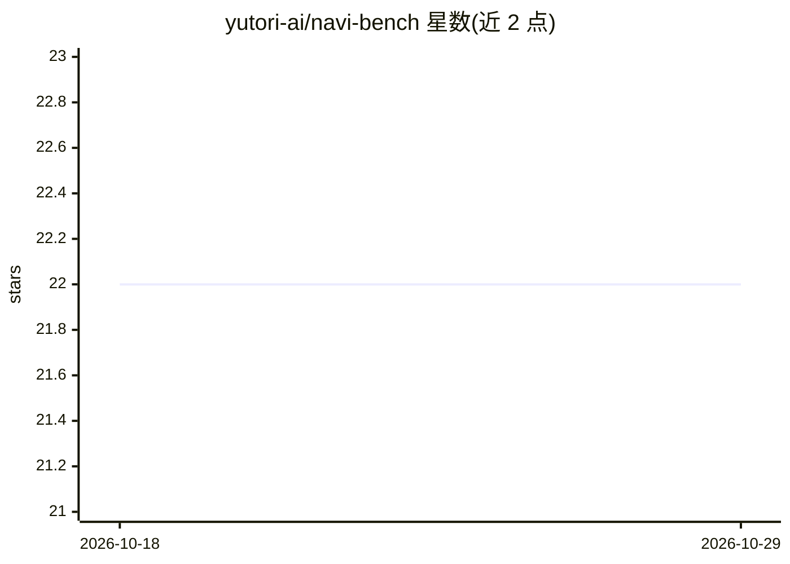

# yutori-ai/navi-bench

⭐ 22 · Python · Apache-2.0 · 推送 2026-10-02 · [GitHub](https://github.com/yutori-ai/navi-bench) · [官网](https://yutori.com/blog/introducing-navigator) · 组织维护

**在真实网站上评测 Web Agent 日常任务表现的基准**

Yutori 维护的 web agent 评测基准：包含来自 Apartments、Craigslist、OpenTable、Resy、Google Flights 五个真实网站的 100 个任务，数据集托管于 HuggingFace。提供 human-in-the-loop 演示供人工试跑任务，以及针对 Yutori Navigator 模型的参考评测脚本（可作为评测自研 agent 的模板）。评测依赖站点状态做校验，输出下界/排除崩溃/上界三种分数，并生成带截图标注的轨迹可视化。限制：部分网站会拦截自动浏览器，需配置远程浏览器（如 BrightData CDP）。

## 筛选速览

| 维度 | 判定 | 备注 |
|---|---|---|
| AI 角色 | `ai-ecosystem` | LLM/agent 周边工具 |
| 许可风险 | `permissive` | Apache-2.0 |
| 部署形态 | `library` | 以包/库形式分发 |
| 模型依赖 | — | README 未给出锁定关系 |
| 硬件要求 | — | 无带数字的原话,不猜 |
| 安装摩擦 | `low` | 无编译、无系统依赖或容器化 |
| 成熟度 | — | 结构信号不足 |

## 能力要点

- 100 个任务来自五个真实网站（租房、分类信息、订餐、机票等）
- human-in-the-loop 演示可人工体验任务
- 参考评测脚本保留完整轨迹并生成截图标注的可视化 HTML
- 支持同 schema 的其他数据集（如 Halluminate Westworld）联合评测

## 适用场景

- 评测自研 web agent 在真实网站日常任务上的表现
- 人工试跑基准任务以理解任务形态
- 对比不同 agent 在真实站点上的成功率与崩溃率

## 场景标签

`模型评测` · 领域:评测与运维

## 证据(README 行号)

> L2: A benchmark for evaluating web agents on everyday tasks directly on real websites.
> L46: We provide an evaluation script for the Yutori Navigator model. You can use it as a reference for evaluating your o

## 星数曲线

2026-10-18 22 → 2026-10-29 22（+0）

---
*卡片 v1 · prompt 1.4 · 生成 2026-10-27 · 置信度 high · 依据 README sha `14a90ac829dd` · [字段定义](../../DATASET.md)*
