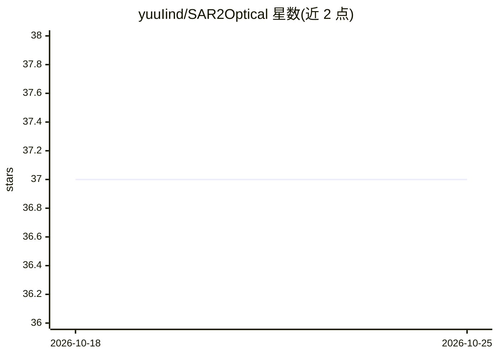

# yuuIind/SAR2Optical

⭐ 37 · Jupyter Notebook · MIT · 推送 2026-04-05 · [GitHub](https://github.com/yuuIind/SAR2Optical) · [官网](https://huggingface.co/spaces/yuulind/sar2rgb) · 个人维护

**Pix2Pix CGAN 实现：SAR 雷达图像转光学 RGB 图像**

基于 PyTorch 的 Pix2Pix 条件 GAN 图像翻译实现，将 Sentinel-1 合成孔径雷达（SAR）图像转换为 Sentinel-2 光学 RGB 图像。使用 TUM 的 Sentinel-1&2 配对数据集（约 16,000 对，train/val/test 划分随 split.json 提供），提供数据下载脚本、训练、评估（PSNR/SSIM、FID）、单图推理与 ONNX 导出流程；已训练的生成器/判别器权重（FID 185-190）上传至 Hugging Face hub 和 Kaggle。安装使用 uv 管理依赖，默认装 CPU 版 PyTorch，可选 CUDA 12.8/13.0 与训练、数据、导出等依赖组。

## 筛选速览

| 维度 | 判定 | 备注 |
|---|---|---|
| AI 角色 | `ai-native` | 本体是模型或模型工具 |
| 许可风险 | `permissive` | MIT |
| 部署形态 | `None` |  |
| 模型依赖 | — | README 未给出锁定关系 |
| 硬件要求 | — | 无带数字的原话,不猜 |
| 安装摩擦 | `medium` | 含编译或系统依赖之一 |
| 成熟度 | — | 结构信号不足 |

## 能力要点

- Pix2Pix CGAN 训练/评估/单图推理/ONNX 导出全流程
- 基于 Sentinel-1&2 配对数据集（约 16,000 对）与预定义 split
- 预训练生成器/判别器权重托管于 Hugging Face hub 与 Kaggle
- uv 管理依赖，默认 CPU 版 PyTorch，可选 CUDA 12.8/13.0

## 适用场景

- 把 SAR 卫星图像转换为可视化的光学风格图像
- 复现或继续训练 Pix2Pix 条件 GAN 图像翻译实验
- 导出 ONNX 模型并做脱离 PyTorch 的推理

## 场景标签

`图像生成` · 领域:内容生成

## 证据(README 行号)

> L5: This is a Pix2Pix CGAN implementation for translating Synthetic Aperture Radar (SAR) images to optical images.
> L51: |1|pix2pix_gen_180.pth|Generator|Pix2Pix generator with transpose convolution, 180 epochs. **FID score is 185.04**|

## 星数曲线

2026-10-18 37 → 2026-10-25 37（+0）

---
*卡片 v1 · prompt 1.4 · 生成 2026-10-25 · 置信度 high · 依据 README sha `1ee914863cbc` · [字段定义](../../DATASET.md)*
