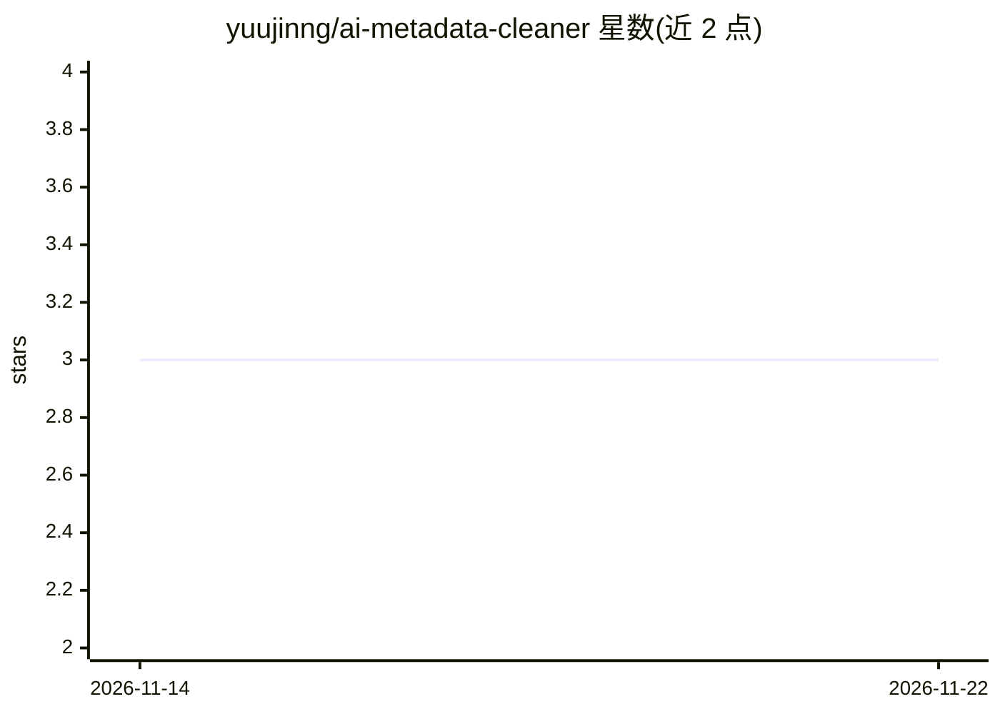

# yuujinng/ai-metadata-cleaner

⭐ 3 · Python · MIT · 推送 2026-11-18 · [GitHub](https://github.com/yuujinng/ai-metadata-cleaner) · 个人维护 · 中文 README

**一键清除 Office/PDF 文档元数据中 AI 生成痕迹的 Windows 工具**

面向 Windows 的图形界面与命令行工具，读取 Word/Excel/PPT/PDF 文档属性，自动标记疑似 AI 生成痕迹（作者、生成程序、时间与编辑统计特征、WPS 云文档指纹、PDF Info/XMP 字典等），支持批量清除或改写任意属性；只改写 ZIP 包内的属性部件，正文逐字节保留，覆盖模式先写临时文件再原子替换。提供 Releases 单文件 exe、源码运行与 scan/clean/set 三个 CLI 子命令（--json 输出、语义化退出码），README 给出写入 AGENTS.md 供 agent 在文档交付前自动调用的规则模板。仅处理元数据层，不检测正文文风；旧版 .doc/.xls/.ppt 二进制格式暂不支持。

## 筛选速览

| 维度 | 判定 | 备注 |
|---|---|---|
| AI 角色 | `ai-enhanced` | 去掉 AI 部分产品仍成立 |
| 许可风险 | `permissive` | MIT |
| 部署形态 | `desktop` | 安装包/桌面程序 |
| 模型依赖 | — | README 未给出锁定关系 |
| 硬件要求 | — | 无带数字的原话,不猜 |
| 安装摩擦 | `low` | 无编译、无系统依赖或容器化 |
| 成熟度 | — | 结构信号不足 |

## 能力要点

- 按关键词与结构指纹自动标红疑似 AI 痕迹（ChatGPT/Claude/python-docx/时间统计异常/WPS ICV 等）
- 只改写 docProps 与 PDF Info/XMP 部件，正文逐字节保留，覆盖模式原子替换
- CLI 提供 --json 输出与 0/1/2 语义化退出码，供脚本与 AI Agent 程序化调用
- Releases 单文件 exe 双击即用，无需安装 Python，全程本地处理

## 适用场景

- 用 ChatGPT/Claude 等 agent 生成文档后，交付前清除属性中的生成来源
- 批量给整批 Word/PDF 文档统一作者等属性
- 排查收到的文档是否带有脚本生成或 WPS 云文档指纹

## 场景标签

 · 领域:文档工具/隐私

## 证据(README 行号)

> L5: **一键清除或修改 Word / Excel / PPT / PDF 的属性（元数据），抹掉 AI 生成痕迹**
> L32: - 🖥️ **命令行模式** — `scan` / `clean` / `set` 子命令，支持批量与脚本自动化，与 GUI 共用同一套核心逻辑；`--json` 输出 + 语义化退出码，方便脚本与 AI Agent 程序化调用
> L26: - 🤖 **AI 痕迹自动识别** — `ChatGPT`、`Claude`、`python-docx`、`openpyxl`、`Skia/PDF` 等生成来源自动标红；作者/生成程序/时间统计类字段默认勾选，标题等正文类字段只提

## 星数曲线

2026-11-14 3 → 2026-11-22 3（+0）

---
*卡片 v1 · prompt 1.4 · 生成 2026-11-21 · 置信度 high · 依据 README sha `39bc21189801` · [字段定义](../../DATASET.md)*
