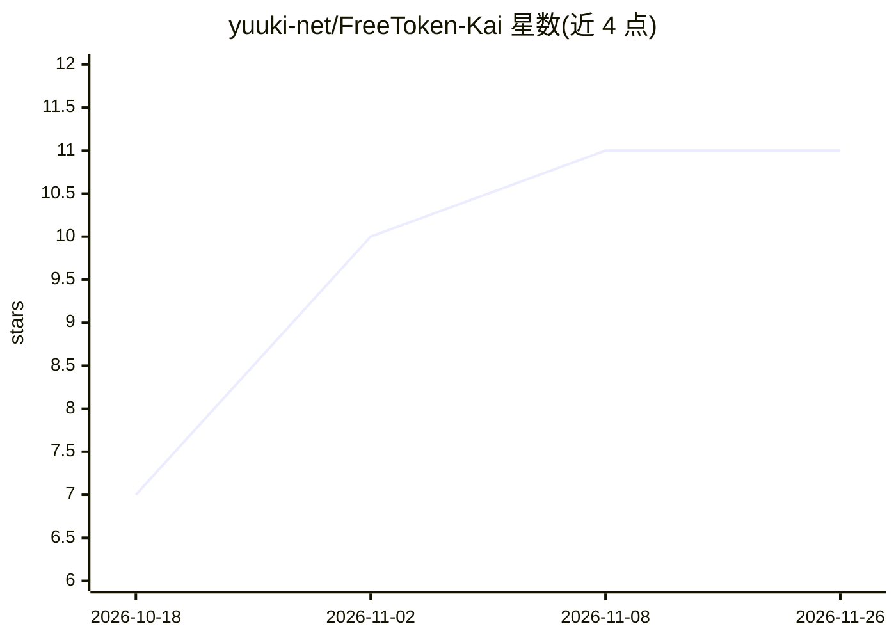

# yuuki-net/FreeToken-Kai

⭐ 11 · Python · Apache-2.0 · 推送 2026-11-18 · [GitHub](https://github.com/yuuki-net/FreeToken-Kai) · 个人维护 · 中文 README

**FreeToken 非官方分支：消费级 GPU 本地跑大模型并自动调参**

FlashML-org/FreeToken 的非官方分支（Apache-2.0，与上游无关联），面向想在自有 PC 上运行大模型但不想手工调参数的用户。核心机制是浏览器端 benchmark：先测量本机 PCIe/内存/SSD 与专家在 CPU/GPU 的吞吐，再逐项尝试 `ft serve` 各参数（KV 缓存、prefill、流水线切分、MTP、上下文长度），生成可一键启动的配置档。分支相对上游的改动包括双消费级 GPU 层切分（`--pp-size 2`，无需 NCCL/P2P）、Turing sm_75 卡修复、Q2_0 GGUF 专家读取、CPU 视觉塔、`ft mgr` Web 控制台与仪表盘。AMD ROCm 仍为上游进行中的实验性工作，本分支未在 AMD GPU 上运行验证。

## 筛选速览

| 维度 | 判定 | 备注 |
|---|---|---|
| AI 角色 | `ai-ecosystem` | LLM/agent 周边工具 |
| 许可风险 | `permissive` | Apache-2.0 |
| 部署形态 | `library` | 以包/库形式分发 |
| 模型依赖 | — | README 未给出锁定关系 |
| 硬件要求 | — | 无带数字的原话,不猜 |
| 安装摩擦 | `high` | 编译与系统依赖俱全 |
| 成熟度 | — | 结构信号不足 |

## 能力要点

- 浏览器 benchmark 逐项试参并生成启动配置档，Recommended 按本机 GPU/RAM 提议参数
- 双消费级 GPU 跑一个模型：层切分走 gloo，无需 NCCL 与 P2P
- 支持 Turing（RTX 2060/20 系列，sm_75），给出六种报错症状的修复文档
- Web 控制台提供仪表盘、专家命中率热图与逐层耗时分析

## 适用场景

- 在单张 12 GB RTX 3060 上本地运行 gpt-oss-120b 或 125B MoE
- 双 GPU 消费级主板上绕过 P2P 限制跑流水线切分
- RTX 2060 等 Turing 卡上游报非法内存访问时寻找可用配置
- 不想逐个学习 serve 参数、让基准测试自动选最优设置

## 场景标签

`推理引擎` · 领域:训练与推理

## 证据(README 行号)

> L11: > An unofficial fork of FlashML-org/FreeToken, merged
> L152: **Benchmark** measures this PC with the model and picks the flags from the numbers. It first runs
> L194: Upstream FreeToken serves one model on one GPU, on Ampere (RTX 30 series) or newer. Underneath the

## 星数曲线

2026-10-18 7 → 2026-11-26 11（+4）

---
*卡片 v1 · prompt 1.4 · 生成 2026-11-18 · 置信度 high · 依据 README sha `52c084ee0761` · [字段定义](../../DATASET.md)*
