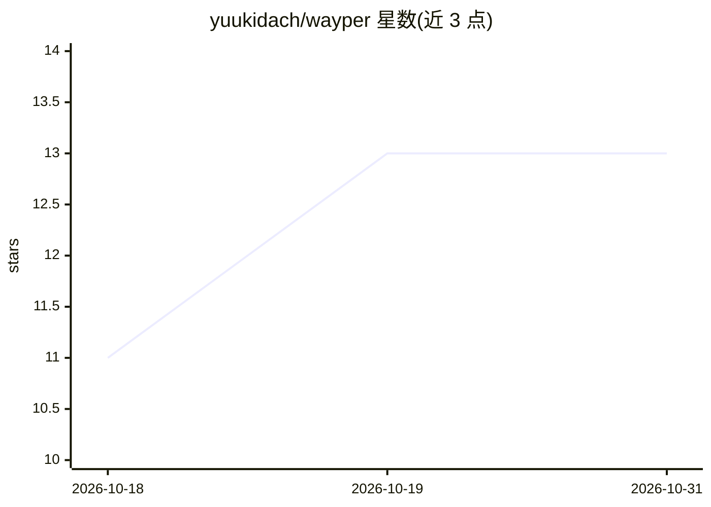

# yuukidach/wayper

⭐ 13 · Python · MIT · 推送 2026-10-23 · [GitHub](https://github.com/yuukidach/wayper) · [官网](https://yuukidach.github.io/wayper/) · 个人维护 · 中文 README

**桌面壁纸管理器：自动下载/轮换 Wallhaven 壁纸，可被 AI 助手控制**

面向桌面用户的 Wallhaven 壁纸客户端：自动下载、轮换与管理壁纸，提供键盘驱动的 GUI、CLI 与 MCP server 三种入口。偏好学习基于本地元数据（标签/颜色/类别，不读取像素），通过 FastEmbed + bge-small 语义向量与 KNN 检索、全局分类头和校准边界过滤下载，Keep/Dislike 显式反馈作为训练标签。内置 MCP server 使 Codex/Claude 可执行换壁纸、收藏、封禁等 15 种工具。支持 Windows/macOS/Linux，自动登录与开机自启。

## 筛选速览

| 维度 | 判定 | 备注 |
|---|---|---|
| AI 角色 | `ai-enhanced` | 去掉 AI 部分产品仍成立 |
| 许可风险 | `permissive` | MIT |
| 部署形态 | `desktop` | 安装包/桌面程序 |
| 模型依赖 | — | README 未给出锁定关系 |
| 硬件要求 | — | 无带数字的原话,不猜 |
| 安装摩擦 | `low` | 无编译、无系统依赖或容器化 |
| 成熟度 | — | 结构信号不足 |

## 能力要点

- 内置 MCP server，Codex/Claude 可自然语言控制壁纸（15 个工具）
- 基于本地元数据的偏好学习模型（FastEmbed + KNN + 校准分类头），不读取图像像素
- GUI 全键盘操作，含 Review 视图教学与自动暂存队列
- 同步 Wallhaven 收藏与标签黑名单，横竖屏自动匹配

## 适用场景

- 自动下载并轮换符合个人偏好的 Wallhaven 壁纸
- 通过对话让 AI 助手切换、收藏或封禁壁纸
- 对自动下载结果做 Keep/Dislike 反馈训练过滤模型

## 场景标签

 · 领域:桌面工具/壁纸管理

## 证据(README 行号)

> L18: Most wallpaper tools stop at "set image on desktop." wayper is a full **Wallhaven client** that auto-downloads, cur
> L23: - **AI-native (MCP)** — built-in MCP server. Tell Codex or Claude *"switch to something with mountains"* or *"favor
> L149: `wayper model train` learns from local Wallhaven metadata only: normalized tags and

## 星数曲线

2026-10-18 11 → 2026-10-31 13（+2）

---
*卡片 v1 · prompt 1.4 · 生成 2026-10-31 · 置信度 mid · 依据 README sha `dbacc0ad0fd4` · [字段定义](../../DATASET.md)*
