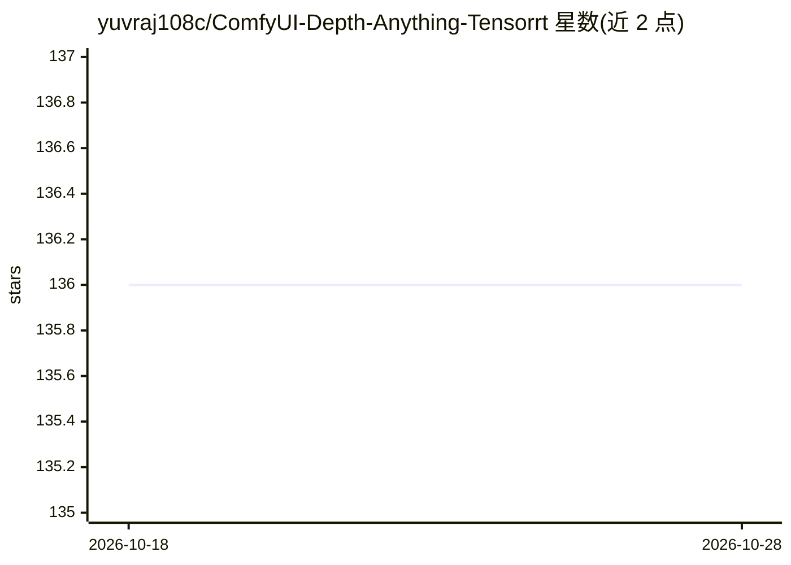

# yuvraj108c/ComfyUI-Depth-Anything-Tensorrt

⭐ 136 · Python · NOASSERTION · 推送 2026-06-04 · [GitHub](https://github.com/yuvraj108c/ComfyUI-Depth-Anything-Tensorrt) · 个人维护

**ComfyUI 的 Depth Anything TensorRT 深度图生成自定义节点**

在 ComfyUI 中以 TensorRT 引擎运行 Depth Anything 系列（v1/v2/v3/distill-any-depth）模型生成深度图的自定义节点。支持通过 EngineBuilder 节点自动下载 ONNX 模型并构建引擎，或手动运行 export_trt.py 导出；提供基础节点输出灰度深度图、Advanced 节点输出原始深度值，并带 GPU 时间稳定器（抑制视频深度图闪烁）与多种 colormap 的深度图显示节点。要求 CUDA 环境与 NVIDIA GPU，安装方式为 git clone 到 custom_nodes 目录后 pip 安装依赖。

## 筛选速览

| 维度 | 判定 | 备注 |
|---|---|---|
| AI 角色 | `ai-native` | 本体是模型或模型工具 |
| 许可风险 | `none` | NOASSERTION |
| 部署形态 | `library` | 以包/库形式分发 |
| 模型依赖 | — | README 未给出锁定关系 |
| 硬件要求 | — | 无带数字的原话,不猜 |
| 安装摩擦 | `medium` | 含编译或系统依赖之一 |
| 成熟度 | — | 结构信号不足 |

## 能力要点

- 支持 Depth Anything v1/v2/v3 与 Distill-Any-Depth 四系列模型
- EngineBuilder 节点可在 ComfyUI 内自动下载模型并构建 TensorRT 引擎
- GPU 时间稳定器节点用 CUDA 平滑抑制视频深度图帧间闪烁
- 深度图显示节点支持 19 种 colormap 与对比度/亮度/gamma/百分位裁剪调节

## 适用场景

- 在 ComfyUI 工作流中快速生成图像/视频深度图
- 为视频深度估计做时间稳定性处理
- 用 colormap 与色调参数可视化深度图用于调试或展示

## 场景标签

`图像视频处理` · 领域:感知与多模态

## 证据(README 行号)

> L8: This repo provides a ComfyUI Custom Node implementation of the Depth-Anything-Tensorrt in Python for ultra fast dept
> L112: - Returns a grayscale depth image (IMAGE type) ready for direct use in workflows

## 星数曲线

2026-10-18 136 → 2026-10-28 136（+0）

---
*卡片 v1 · prompt 1.4 · 生成 2026-10-22 · 置信度 mid · 依据 README sha `1037875d68a2` · [字段定义](../../DATASET.md)*
