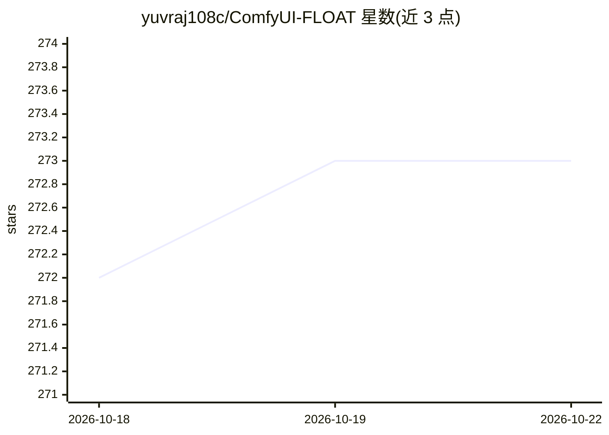

# yuvraj108c/ComfyUI-FLOAT

⭐ 273 · Python · 推送 2026-06-05 · [GitHub](https://github.com/yuvraj108c/ComfyUI-FLOAT) · 个人维护

**ComfyUI 节点：音频驱动人像说话视频生成（FLOAT）**

FLOAT 论文（Generative Motion Latent Flow Matching for Audio-driven Talking Portrait）的 ComfyUI 封装节点：输入驱动图像与音频，生成对口型的说话人像视频。模型（float.pth 主模型与 wav2vec2 音频编码器）首次使用时自动下载到 ComfyUI/models/float。通过 git clone 源码并 pip 安装依赖集成进 ComfyUI，加载示例工作流即可使用。README 声明已有维护更活跃的 ComfyUI-FLOAT_Optimized 版本，许可证为 CC BY-NC-SA 4.0（非商业）。

## 筛选速览

| 维度 | 判定 | 备注 |
|---|---|---|
| AI 角色 | `ai-native` | 本体是模型或模型工具 |
| 许可风险 | `none` | — |
| 部署形态 | `library` | 以包/库形式分发 |
| 模型依赖 | — | README 未给出锁定关系 |
| 硬件要求 | — | 无带数字的原话,不猜 |
| 安装摩擦 | `medium` | 含编译或系统依赖之一 |
| 成熟度 | — | 结构信号不足 |

## 能力要点

- 音频驱动的人像说话视频生成（flow matching）
- 模型自动下载到 ComfyUI/models/float 目录
- 提供示例工作流，上传图像与音频即可运行

## 适用场景

- 在 ComfyUI 中用音频生成对口型的说话人像视频
- 为虚拟角色或配音内容生成唇同步动画

## 场景标签

 · 领域:生成式视频/数字人

## 证据(README 行号)

> L7: This project provides a ComfyUI wrapper of FLOAT for Generative Motion Latent Flow Matching for Audio-driven Talking
> L44: - Upload driving image and audio, click queue

## 星数曲线

2026-10-18 272 → 2026-10-22 273（+1）

---
*卡片 v1 · prompt 1.4 · 生成 2026-10-22 · 置信度 mid · 依据 README sha `b7cb724ee095` · [字段定义](../../DATASET.md)*
