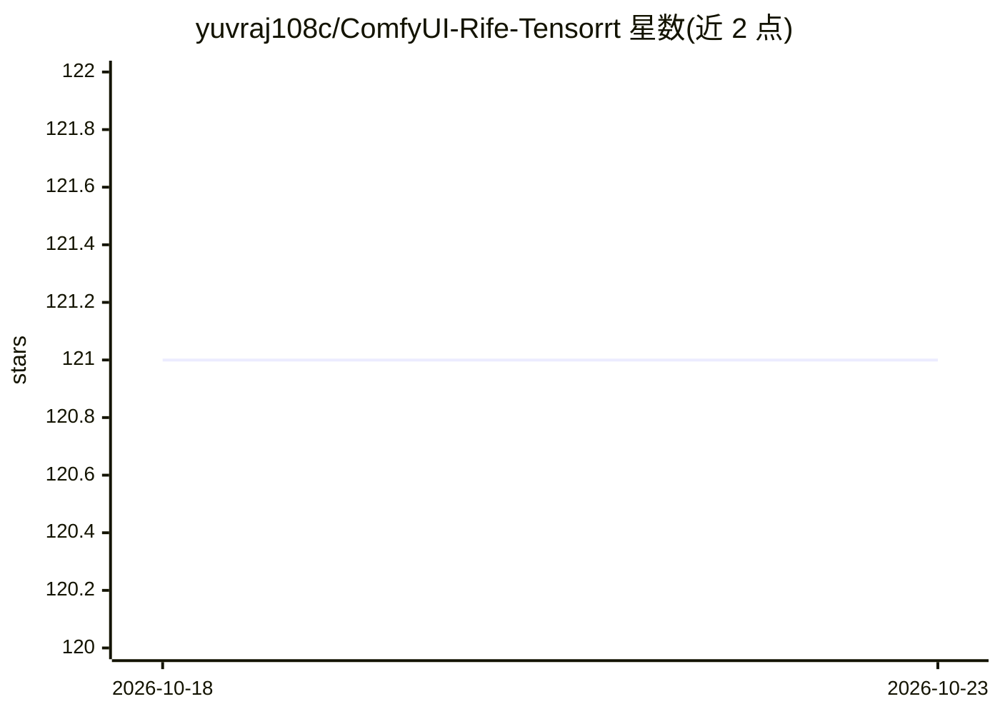

# yuvraj108c/ComfyUI-Rife-Tensorrt

⭐ 121 · Python · NOASSERTION · 推送 2026-06-08 · [GitHub](https://github.com/yuvraj108c/ComfyUI-Rife-Tensorrt) · 个人维护

**ComfyUI 的 RIFE TensorRT 帧插值节点，加速视频补帧**

ComfyUI 自定义节点，以 TensorRT 引擎运行 RIFE 模型做视频帧插值，支持 rife47/rife48/rife49 三种模型，首次使用时从 HuggingFace 自动下载模型并构建 TensorRT 引擎，支持 fp16/fp32 精度与 256x256 至 3840x3840 分辨率输入。通过两节点系统（Load Model + Rife Tensorrt）使用，安装方式为在 custom_nodes 目录 git clone 并安装依赖。需 CUDA 环境，README 在 H100 上给出基准数据，许可为 CC BY-NC-SA 4.0（禁止商用）。

## 筛选速览

| 维度 | 判定 | 备注 |
|---|---|---|
| AI 角色 | `ai-native` | 本体是模型或模型工具 |
| 许可风险 | `none` | NOASSERTION |
| 部署形态 | `library` | 以包/库形式分发 |
| 模型依赖 | — | README 未给出锁定关系 |
| 硬件要求 | — | 无带数字的原话,不猜 |
| 安装摩擦 | `medium` | 含编译或系统依赖之一 |
| 成熟度 | — | 结构信号不足 |

## 能力要点

- TensorRT 实现 RIFE 帧插值，提供 rife47/48/49 三种模型
- 模型自动从 HuggingFace 下载并按需构建引擎
- 支持 256x256 至 3840x3840 分辨率与 fp16/fp32 精度
- 两节点工作流：Load Rife Tensorrt Model + Rife Tensorrt

## 适用场景

- 我在 ComfyUI 里给视频做帧率倍增
- 需要 GPU 加速的帧插值处理低帧率视频素材
- 制作平滑慢动作或补帧动画

## 场景标签

 · 领域:图像/视频处理

## 证据(README 行号)

> L8: This project provides a TensorRT implementation of RIFE for ultra fast frame interpolation inside ComfyUI
> L67: 2. **Process Frames**: Insert `Right Click -> Add Node -> tensorrt -> Rife Tensorrt`

## 星数曲线

2026-10-18 121 → 2026-10-23 121（+0）

---
*卡片 v1 · prompt 1.4 · 生成 2026-10-23 · 置信度 mid · 依据 README sha `b13ab37e56bd` · [字段定义](../../DATASET.md)*
