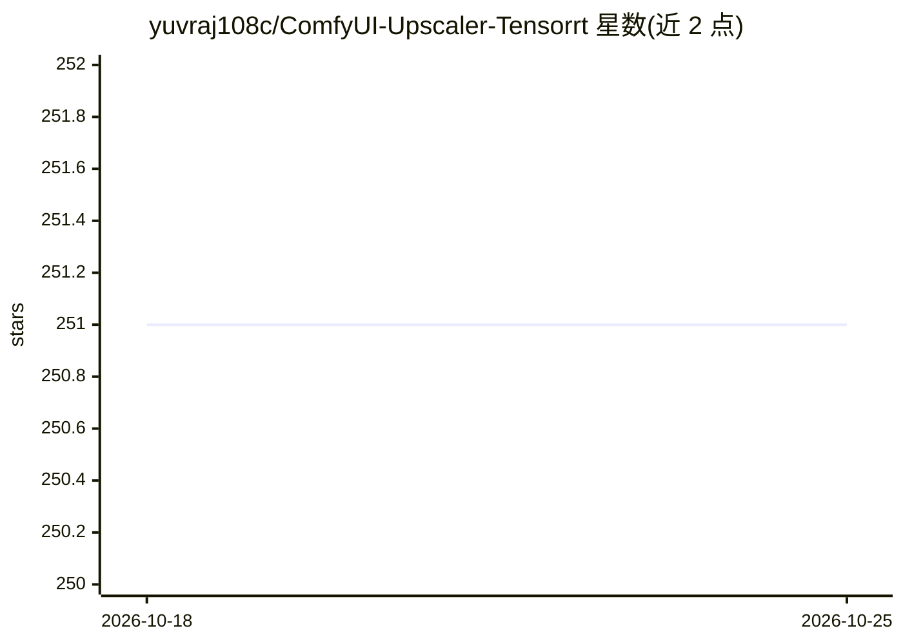

# yuvraj108c/ComfyUI-Upscaler-Tensorrt

⭐ 252 · Python · NOASSERTION · 推送 2026-06-07 · [GitHub](https://github.com/yuvraj108c/ComfyUI-Upscaler-Tensorrt) · 个人维护

**ComfyUI 节点：用 TensorRT 加速 ESRGAN 图像超分（2-4x）**

ComfyUI 自定义节点，将 ESRGAN 架构超分模型（4x-UltraSharp、RealESRGAN 等 13 个已测试模型）转为 TensorRT 引擎执行，README 报告较常规路径提速 2-4 倍，附 RTX 5090/4090/3060 的 FPS 基准。引擎在工作流中自动构建，支持 256-1280px 动态输入分辨率与任意放大倍数，可用 export_onnx.py 导出自定义 ESRGAN 模型。需 NVIDIA GPU 环境，仅支持 ESRGAN 架构。通过 ComfyUI Manager 或 git clone 安装。

## 筛选速览

| 维度 | 判定 | 备注 |
|---|---|---|
| AI 角色 | `ai-ecosystem` | LLM/agent 周边工具 |
| 许可风险 | `none` | NOASSERTION |
| 部署形态 | `library` | 以包/库形式分发 |
| 模型依赖 | — | README 未给出锁定关系 |
| 硬件要求 | — | 无带数字的原话,不猜 |
| 安装摩擦 | `medium` | 含编译或系统依赖之一 |
| 成熟度 | — | 结构信号不足 |

## 能力要点

- 13 个已测试 ESRGAN 超分模型的 TensorRT 执行
- 引擎从工作流自动构建，支持 256-1280px 动态分辨率
- export_onnx.py 支持导出自定义 ESRGAN 模型
- 附 RTX 5090/4090/3060 的 FP16 基准数据（FPS）

## 适用场景

- 在 ComfyUI 工作流中加速图像超分放大
- 把生成或低分辨率图像放大到 2048-5120px
- 为自定义 ESRGAN 模型构建 TensorRT 引擎

## 场景标签

`图像视频处理` · 领域:感知与多模态

## 证据(README 行号)

> L8: This project provides a Tensorrt implementation for fast image upscaling using models inside ComfyUI (2-4x faster)
> L81: - The tensorrt engine will be built automatically

## 星数曲线

2026-10-18 251 → 2026-10-25 251（+0）

---
*卡片 v1 · prompt 1.4 · 生成 2026-10-22 · 置信度 mid · 依据 README sha `875267bbc697` · [字段定义](../../DATASET.md)*
