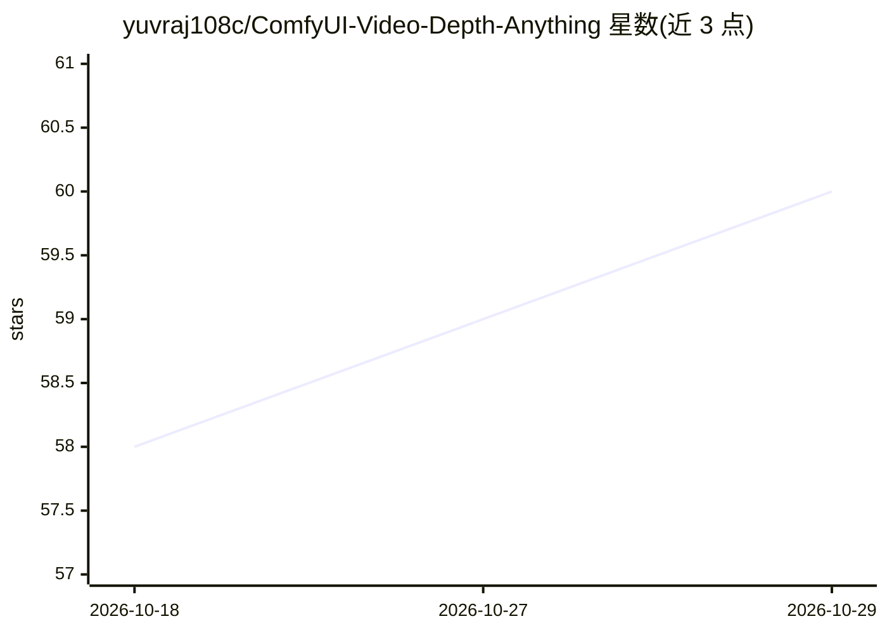

# yuvraj108c/ComfyUI-Video-Depth-Anything

⭐ 60 · Python · Apache-2.0 · 推送 2026-01-08 · [GitHub](https://github.com/yuvraj108c/ComfyUI-Video-Depth-Anything) · 个人维护

**ComfyUI 节点：对长视频做一致性深度估计**

Video Depth Anything 的非官方 ComfyUI 实现，以 custom_nodes 形式接入 ComfyUI，对长视频执行深度估计，支持 6 个模型权重（vits/vitb/vitl 及 metric 变体），模型可自动下载到 ComfyUI/models 目录，也可手动放置。提供 input_size、max_res、precision（默认 fp16）参数。安装方式为 git clone 到 custom_nodes 目录并 pip install 依赖，需在 GPU（README 测试环境为 RTX5090/CUDA）环境运行。

## 筛选速览

| 维度 | 判定 | 备注 |
|---|---|---|
| AI 角色 | `ai-native` | 本体是模型或模型工具 |
| 许可风险 | `permissive` | Apache-2.0 |
| 部署形态 | `library` | 以包/库形式分发 |
| 模型依赖 | — | README 未给出锁定关系 |
| 硬件要求 | — | 无带数字的原话,不猜 |
| 安装摩擦 | `medium` | 含编译或系统依赖之一 |
| 成熟度 | — | 结构信号不足 |

## 能力要点

- 对长视频输出一致的深度估计
- 支持 6 个模型权重（vits/vitb/vitl 及 metric 变体）
- 模型自动下载或手动放置到 /ComfyUI/models/videodepthanything
- 提供 input_size/max_res/precision 推理参数

## 适用场景

- 在 ComfyUI 工作流中对长视频生成深度图
- 为视频后期处理（如景深效果、风格化）提供深度序列

## 场景标签

`图像视频处理` · 领域:感知与多模态

## 证据(README 行号)

> L3: Project Page
> L42: - Supported models: 'video_depth_anything_vits.pth', 'video_depth_anything_vitb.pth', 'video_depth_anything_vitl.pt

## 星数曲线

2026-10-18 58 → 2026-10-29 60（+2）

---
*卡片 v1 · prompt 1.4 · 生成 2026-10-24 · 置信度 mid · 依据 README sha `2d69002496f9` · [字段定义](../../DATASET.md)*
