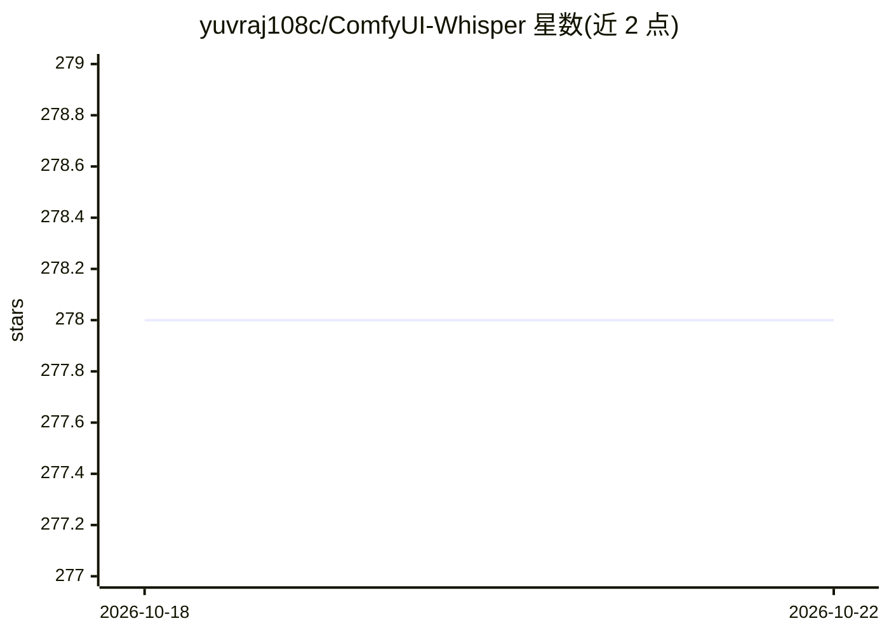

# yuvraj108c/ComfyUI-Whisper

⭐ 278 · Python · NOASSERTION · 推送 2026-06-07 · [GitHub](https://github.com/yuvraj108c/ComfyUI-Whisper) · 个人维护

**ComfyUI 的 Whisper 节点：转录音频并为视频生成字幕**

ComfyUI 自定义节点集合，提供 Apply Whisper（音频转录并输出分段与逐词时间戳）、Add Subtitles To Frames（在视频帧上叠加字幕，可设置字体、颜色与位置）、Add Subtitles To Background（词云式字幕，实验性）与 Save SRT（导出 SRT 文件）等节点。支持多语言、Prompt 引导与 tiny 至 large-v3-turbo 等多种 Whisper 模型，模型自动下载到 ComfyUI 模型目录。通过 ComfyUI Manager 安装，面向 ComfyUI 工作流用户。

## 筛选速览

| 维度 | 判定 | 备注 |
|---|---|---|
| AI 角色 | `ai-ecosystem` | LLM/agent 周边工具 |
| 许可风险 | `none` | NOASSERTION |
| 部署形态 | `None` |  |
| 模型依赖 | — | README 未给出锁定关系 |
| 硬件要求 | — | 无带数字的原话,不猜 |
| 安装摩擦 | `medium` | 含编译或系统依赖之一 |
| 成熟度 | — | 结构信号不足 |

## 能力要点

- Whisper 音频转录，输出分段与逐词时间戳
- 视频帧字幕叠加（字体/颜色/位置可配置）与实验性词云字幕
- 支持 tiny 至 large-v3-turbo 共 14 种 Whisper 模型
- 对齐结果可导出为 SRT 文件

## 适用场景

- 在 ComfyUI 工作流中为视频自动生成字幕
- 转录音频并获取精确时间戳
- 导出 SRT 字幕文件用于后期制作

## 场景标签

 · 领域:音视频处理/AIGC 工作流

## 证据(README 行号)

> L3: Transcribe audio and add subtitles to videos using Whisper in ComfyUI.
> L42: ### Apply Whisper

## 星数曲线

2026-10-18 278 → 2026-10-22 278（+0）

---
*卡片 v1 · prompt 1.4 · 生成 2026-10-22 · 置信度 high · 依据 README sha `03de2048230d` · [字段定义](../../DATASET.md)*
