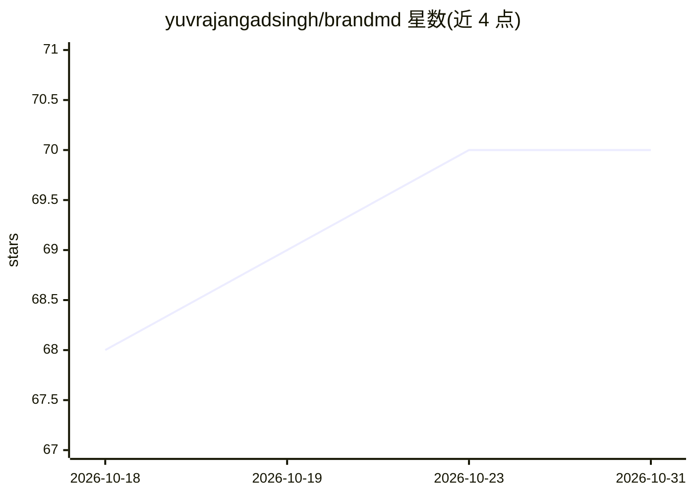

# yuvrajangadsingh/brandmd

⭐ 70 · JavaScript · MIT · 推送 2026-10-08 · [GitHub](https://github.com/yuvrajangadsingh/brandmd) · [官网](https://www.npmjs.com/package/brandmd) · 个人维护

**从任意网站提取设计系统生成 DESIGN.md 供 AI 编码代理使用**

面向使用 Claude Code、Cursor、Gemini CLI 等 AI 编码代理的开发者的 CLI 工具：访问指定 URL，提取颜色、字体、间距、阴影、组件模式与布局规则，生成通过 @google/design.md 官方 lint 的 DESIGN.md（YAML frontmatter 加散文段落），放入项目根目录为代理提供品牌上下文。默认本地提取无需 API key；--vision 需 Gemini API key。支持多 URL 合并、输出 CSS/Tailwind/JSON/HTML 格式，提供 brandmd check 在 CI 中按角色比对颜色做设计漂移检测，遇封锁页/登录墙拒绝并写原子文件。

## 筛选速览

| 维度 | 判定 | 备注 |
|---|---|---|
| AI 角色 | `ai-ecosystem` | LLM/agent 周边工具 |
| 许可风险 | `permissive` | MIT |
| 部署形态 | `library` | 以包/库形式分发 |
| 模型依赖 | — | README 未给出锁定关系 |
| 硬件要求 | — | 无带数字的原话,不猜 |
| 安装摩擦 | `low` | 无编译、无系统依赖或容器化 |
| 成熟度 | — | 结构信号不足 |

## 能力要点

- 生成通过 @google/design.md lint 的规范 DESIGN.md，默认本地运行无需 API key
- 多格式输出：CSS 自定义属性、Tailwind v4 @theme、JSON、HTML 品牌指南
- --agent 同时写入 Cursor 规则与 Claude Code/SKILL.md 技能文件
- brandmd check 在 CI 中按颜色角色（而非十六进制集合）检测设计漂移

## 适用场景

- 让 AI 编码代理在写 UI 前获得我的品牌配色与字体规范
- 把现有网站的设计系统提取为可版本化的 DESIGN.md
- 在 CI 中检测线上页面与设计规范之间的漂移

## 场景标签

`网页抓取` · 领域:效率与自动化

## 证据(README 行号)

> L5: Stop Claude Code, Cursor, and Gemini CLI from guessing your UI. brandmd extracts any website's design system into a 
> L7: AI coding agents generate generic screens when they don't know your colors, fonts, spacing, components, and layout r
> L35: Works as brand context for Claude Code, Cursor rules, Gemini CLI, Codex, Google Stitch, MCP servers, and any coding

## 星数曲线

2026-10-18 68 → 2026-10-31 70（+2）

---
*卡片 v1 · prompt 1.4 · 生成 2026-10-24 · 置信度 high · 依据 README sha `cf89e8f4bd36` · [字段定义](../../DATASET.md)*
