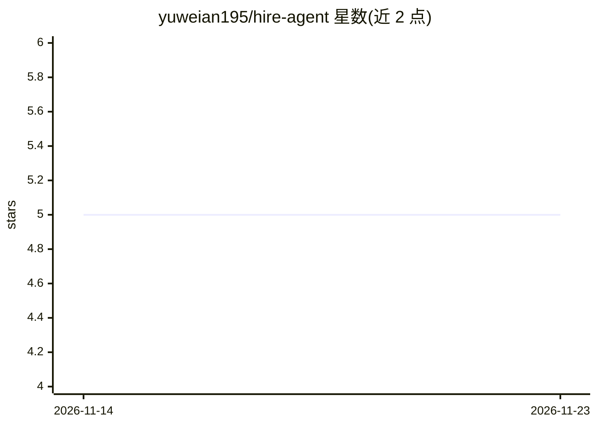

# yuweian195/hire-agent

⭐ 5 · Python · MIT · 推送 2026-11-14 · [GitHub](https://github.com/yuweian195/hire-agent) · 个人维护 · 中文 README

**给中小团队的简历筛选与面试评估 Agent 单机服务**

以 FastAPI 单机服务形式交付的招聘筛选系统：解析 PDF/DOCX 等格式简历，按固定权重的六维规则评分、人岗匹配、批量排名，并基于 LangGraph 状态图编排条件路由与面试评估子图。LLM 仅负责评语、面试题与反馈生成，分数由规则计算；未配置 API Key 时回退离线模板，默认脱敏候选人姓名。附可选 Java Spring Boot ATS 集成服务与 React 招聘看板，数据存于 SQLite。

## 筛选速览

| 维度 | 判定 | 备注 |
|---|---|---|
| AI 角色 | `ai-native` | 本体是模型或模型工具 |
| 许可风险 | `permissive` | MIT |
| 部署形态 | `self-host` | docker 或自建部署 |
| 模型依赖 | locked-api |  |
| 硬件要求 | — | 无带数字的原话,不猜 |
| 安装摩擦 | `low` | 无编译、无系统依赖或容器化 |
| 成熟度 | — | 结构信号不足 |

## 能力要点

- 六维规则评分（权重固定、毫秒级、结果确定），阈值可经环境变量调整
- LangGraph 状态图编排筛选与面试评估子图，保留节点执行轨迹
- 兼容 OpenAI/DeepSeek/通义等 OpenAI-compatible 接口，无 Key 时离线规则模式
- 歧视性 JD 条件识别并从评分依据剔除，默认 PII 脱敏

## 适用场景

- 校招/社招批量导入简历初筛并导出排名 CSV
- 对候选人面试回答逐题评分并生成追问建议
- 通过看板管理候选人五个流程阶段并导出 Markdown 报告

## 场景标签

`文档解析` · 领域:知识与检索

## 证据(README 行号)

> L13: 面向中小团队招聘场景的智能筛选与面试评估系统。覆盖简历解析、六维评分、人岗匹配、批量排名、面试回答评估和候选人流程管理；全流程由 LangGraph 状态图编排，并保留每个节点的执行轨迹。
> L56: - **可选的 LLM 增强**：兼容 OpenAI / DeepSeek / 通义等 OpenAI-compatible 接口；未配置 Key 时自动使用离线规则模式。

## 星数曲线

2026-11-14 5 → 2026-11-23 5（+0）

---
*卡片 v1 · prompt 1.4 · 生成 2026-11-20 · 置信度 high · 依据 README sha `2548d1afd879` · [字段定义](../../DATASET.md)*
