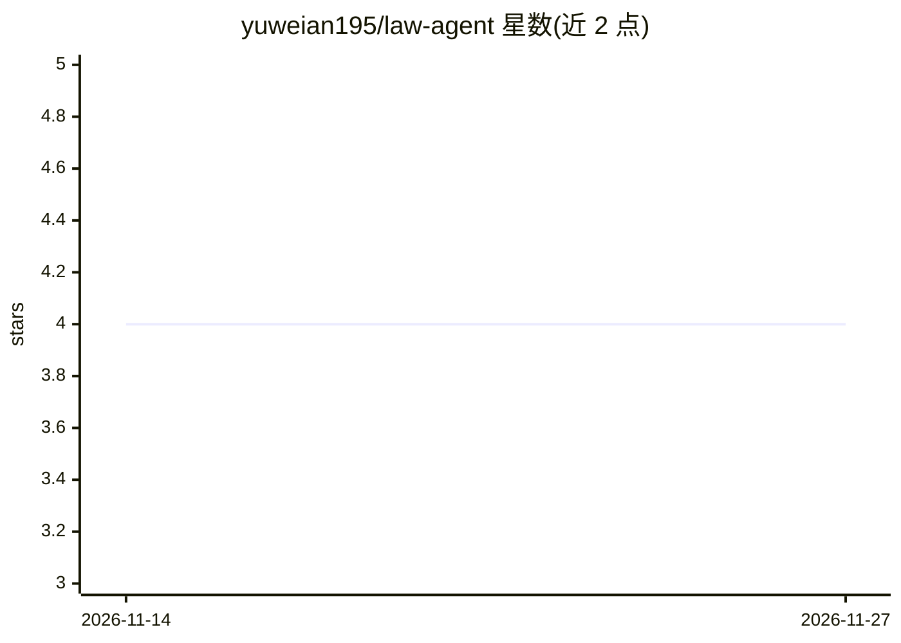

# yuweian195/law-agent

⭐ 4 · Python · MIT · 推送 2026-11-14 · [GitHub](https://github.com/yuweian195/law-agent) · 个人维护 · 中文 README

**劳动争议与合同审查场景的本地法律助手：检索、规则与金额测算**

面向劳动争议与合同审查的本地法律助手，核心链路为：本地 33 条法条库 + 中文字符二元组 BM25 检索（含同义扩展与标题/标签加权），问答只引用检索到的条文；合同风险由 12 条规则引擎识别并打分，金额测算（N/2N/N+1）由独立计算器输出公式与假设；LLM 仅在配置 Key 后负责意见措辞，未配置时用确定性模板全部离线运行。带引用守卫，检索不足时不给确定性结论。FastAPI 后端 + Streamlit 工作台 + React 控制台，SQLite 存储，问答与审查记录可回溯。

## 筛选速览

| 维度 | 判定 | 备注 |
|---|---|---|
| AI 角色 | `ai-native` | 本体是模型或模型工具 |
| 许可风险 | `permissive` | MIT |
| 部署形态 | `self-host` | docker 或自建部署 |
| 模型依赖 | — | README 未给出锁定关系 |
| 硬件要求 | — | 无带数字的原话,不猜 |
| 安装摩擦 | `low` | 无编译、无系统依赖或容器化 |
| 成熟度 | — | 结构信号不足 |

## 能力要点

- BM25 + 中文同义扩展的法条检索，回答仅引用检索到条文，带引用守卫
- 12 条合同风险规则与风险评分（高风险 30 分/项、中风险 10 分/项）
- 经济补偿 N、违法解除 2N、未通知 N+1 金额测算并附公式与假设
- 未配置 LLM Key 时用确定性模板，全部功能可离线运行

## 适用场景

- 劳动争议问题的法条检索与带引用问答
- 劳动合同的风险条款扫描与修改建议
- 解除补偿金额的测算与计算过程核对

## 场景标签

`RAG` · 领域:知识与检索

## 证据(README 行号)

> L12: 面向劳动争议与合同审查场景的本地法律助手。输入一个法律问题或一份合同，系统会检索本地法条、给出带引用的意见、扫描条款风险，并在可计算时给出金额测算。
> L44: - 本地法条库 + BM25 检索，回答只引用检索到的条文；
> L190: 配置后，LLM 负责组织法律意见与审查结论的措辞；**检索、引用、风险规则和金额计算仍由本地逻辑完成**。未配置 Key 时使用确定性模板，全部功能可离线运行。

## 星数曲线

2026-11-14 4 → 2026-11-27 4（+0）

---
*卡片 v1 · prompt 1.4 · 生成 2026-11-21 · 置信度 mid · 依据 README sha `e8bc9f744db6` · [字段定义](../../DATASET.md)*
