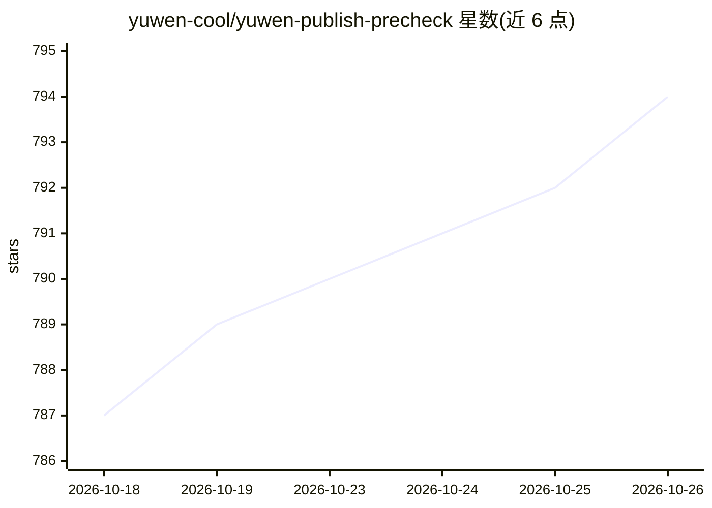

# yuwen-cool/yuwen-publish-precheck

⭐ 794 · Python · MIT · 推送 2026-10-08 · [GitHub](https://github.com/yuwen-cool/yuwen-publish-precheck) · 个人维护 · 中文 README

**给内容创作者的发布前 AI 合规审核技能**

面向抖音、小红书、微信视频号内容发布者的 Agent Skill：以两层机制审核稿件——Python 脚本做词面预检定位候选，再由 AI 结合语境判定违规与否，输出结论、逐条依据（42 条规则锚定《广告法》、网信办文件与平台官方规则，含 80+ 条带链接原文引文）与可直接使用的修改稿。判定尺度经 38 篇平台实际放行的口播稿校准。用户可通过对话把踩坑经验沉淀到本地 data/ 目录规则库，后续审核自动生效。安装方式为 git clone 到 Cursor、Claude Code 等支持 Agent Skills 的工具目录，零第三方依赖，仅 Python 3.10+，本地运行。明确声明不承诺过审、不提供绕审技巧。

## 筛选速览

| 维度 | 判定 | 备注 |
|---|---|---|
| AI 角色 | `ai-native` | 本体是模型或模型工具 |
| 许可风险 | `permissive` | MIT |
| 部署形态 | `None` |  |
| 模型依赖 | — | README 未给出锁定关系 |
| 硬件要求 | — | 无带数字的原话,不猜 |
| 安装摩擦 | `low` | 无编译、无系统依赖或容器化 |
| 成熟度 | — | 结构信号不足 |

## 能力要点

- 词面预检 + 语义语境判定的两层审核机制
- 42 条规则锚定官方来源，80+ 条原文引文带链接与核验日期
- 本地 data/ 规则库沉淀用户踩坑经验，审核复盘中四类归因分析
- 零第三方依赖（仅需 Python 3.10+），完全本地运行

## 适用场景

- 发布前审核口播稿、图文文案能否发抖音/小红书/视频号
- 让 AI 给出可直接使用的合规修改稿并复检
- 被限流或处罚后复盘归因，并把教训固化为本地规则

## 场景标签

`AI 写作` · 领域:内容生成

## 证据(README 行号)

> L12: > 发抖音、小红书、微信视频号之前，先让 AI 帮你审一遍：**能不能发、哪句有问题、怎么改**——并且把你踩过的坑记住，越用越准。
> L23:     B --> C["语义判定 (AI 结合语境下结论)"]
> L87: 请安装这个 skill：https://github.com/yuwen-cool/yuwen-publish-precheck.git

## 星数曲线

2026-10-18 787 → 2026-10-26 794（+7）

---
*卡片 v1 · prompt 1.4 · 生成 2026-10-21 · 置信度 high · 依据 README sha `a923e28fb15d` · [字段定义](../../DATASET.md)*
