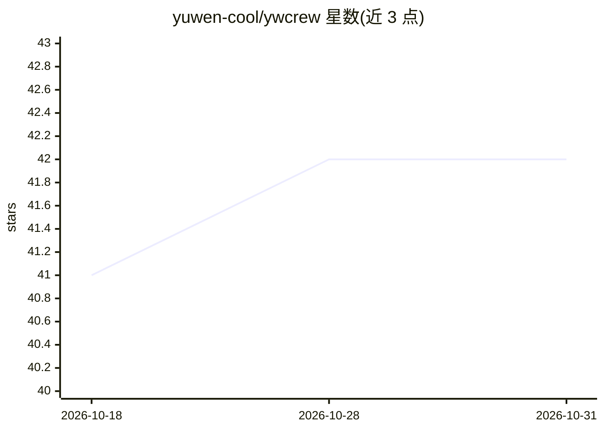

# yuwen-cool/ywcrew

⭐ 42 · TypeScript · MIT · 推送 2026-07-29 · [GitHub](https://github.com/yuwen-cool/ywcrew) · 个人维护 · 中文 README

**让本地订阅的多个 AI 编程智能体互相派活并汇总结果**

面向已订阅多个 AI 编程 CLI（Claude Code、Codex、Grok、Kimi、Antigravity）的开发者的编排工具：在任一宿主智能体（Cursor / Claude Code 等）中用自然语言把任务派给其他后端，子任务在独立进程运行，走各家 CLI 登录态而非 API key。支持并行评审、跨后端追问、edit 任务在隔离 git worktree 中以 patch 交付、结论中的 evidence 自动核验。CLI-first 架构，宿主技能文件按用户真实配置动态渲染，MCP 为可选通道；无 daemon，detached worker 加磁盘状态落盘于 ~/.ywcrew。前置要求 Node ≥ 20，通过 curl 脚本安装。

## 筛选速览

| 维度 | 判定 | 备注 |
|---|---|---|
| AI 角色 | `ai-ecosystem` | LLM/agent 周边工具 |
| 许可风险 | `permissive` | MIT |
| 部署形态 | `library` | 以包/库形式分发 |
| 模型依赖 | — | README 未给出锁定关系 |
| 硬件要求 | — | 无带数字的原话,不猜 |
| 安装摩擦 | `low` | 无编译、无系统依赖或容器化 |
| 成熟度 | — | 结构信号不足 |

## 能力要点

- 并行派单多后端（panel）与跨轮追问（followup），同后端原生续聊
- edit 任务在隔离 git worktree 中执行、以 patch 交付，strict 模式下影子目录物理隔离
- 结论 evidence（文件+行号）由 worker 自动核验并标记 verified
- detached worker 无 daemon，双层槽位锁与心跳惰性回收

## 适用场景

- 在当前对话里让其他模型并行评审多个方案并汇总共识分歧
- 把排查类任务派给别家模型，不打断主对话、不动主对话缓存
- 让多个模型各改一版代码，以 patch 形式挑选采纳
- 复用已有订阅做跨模型协作，不额外烧 API key

## 场景标签

`编码 Agent` `Agent 框架` · 领域:Agent 开发

## 证据(README 行号)

> L6: ywcrew 让它们互相调用：在任何一个智能体里说句话，就能把任务派给其他家的模型。
> L26: - **不烧 API key** —— 所有调用走你已付费的订阅（各家自己的 CLI 登录态）
> L73: |后端|命令|思考强度|原生续聊|只读机制|

## 星数曲线

2026-10-18 41 → 2026-10-31 42（+1）

---
*卡片 v1 · prompt 1.4 · 生成 2026-10-25 · 置信度 mid · 依据 README sha `ad3cea6230c2` · [字段定义](../../DATASET.md)*
