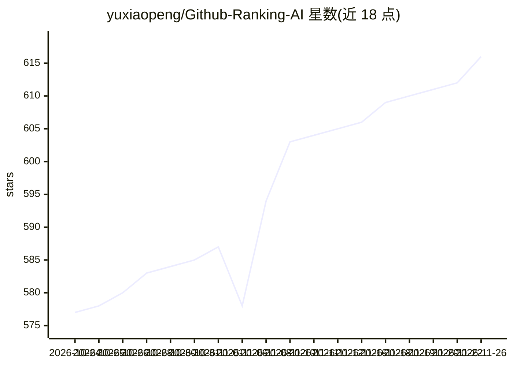

# yuxiaopeng/Github-Ranking-AI

⭐ 616 · Python · MIT · 推送 2026-11-08 · [GitHub](https://github.com/yuxiaopeng/Github-Ranking-AI) · [官网](https://yuxiaopeng.com/Github-Ranking-AI/) · 个人维护 · 中文 README

**面向关注 AI 生态的用户：按 star 数排名的 GitHub AI 仓库榜单，每日自动更新**

以 GitHub Topic 为单位的仓库排名清单，按 star 与 fork 数排序，覆盖 LLM、ChatGPT、OpenAI、DeepSeek、LLaMA、Chatbot 等主题，每日自动更新；每个条目给出排名、项目名、star/fork 数、语言、issue 数、描述与最近提交时间。每类主题展示前 10 名，并提供指向 Top 100 完整榜单的链接。定位为发现与追踪热门 AI 开源项目的索引工具，适合浏览与检索 AI 领域的开源项目动态。

## 筛选速览

| 维度 | 判定 | 备注 |
|---|---|---|
| AI 角色 | `ai-knowledge` | 知识聚合/清单类 |
| 许可风险 | `permissive` | MIT |
| 部署形态 | `None` |  |
| 模型依赖 | — | README 未给出锁定关系 |
| 硬件要求 | — | 无带数字的原话,不猜 |
| 安装摩擦 | `medium` | 含编译或系统依赖之一 |
| 成熟度 | — | 结构信号不足 |

## 能力要点

- 按 GitHub star/fork 数排序的 AI 主题仓库榜单
- 每日自动更新（含最近更新时间戳）
- 覆盖 LLM、ChatGPT、OpenAI、DeepSeek、LLaMA、Chatbot 等多个主题分类
- 每类提供 Top 100 完整榜单链接

## 适用场景

- 想找某个 AI 方向（如 LLM 推理、RAG、微调）star 数靠前的开源项目
- 定期追踪 AI 领域热门仓库的排名变化
- 按语言/主题筛选值得关注的开源 AI 项目

## 场景标签

`精选清单` · 领域:学习与行业

## 证据(README 行号)

> L3: **A list of the most github stars and forks repositories.**
> L5: *Last Automatic Update Time: 2026-11-08T10:12:52Z*
> L9: ## LLM

## 星数曲线

2026-10-24 577 → 2026-11-26 616（+39）

---
*卡片 v1 · prompt 1.4 · 生成 2026-11-25 · 置信度 high · 依据 README sha `5476d718b82f` · [字段定义](../../DATASET.md)*
