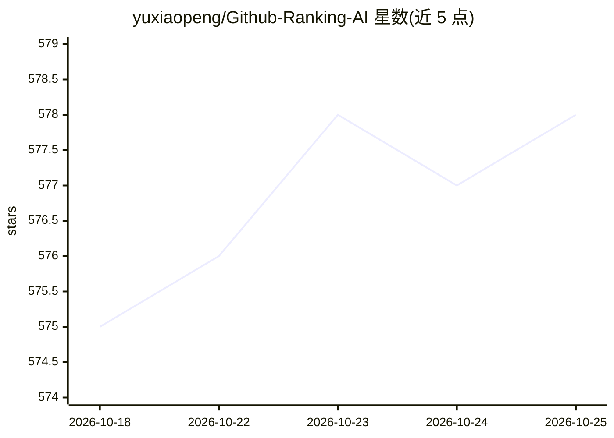

# yuxiaopeng/Github-Ranking-AI

⭐ 580 · Python · MIT · 推送 2026-10-25 · [GitHub](https://github.com/yuxiaopeng/Github-Ranking-AI) · [官网](https://yuxiaopeng.com/Github-Ranking-AI/) · 个人维护 · 中文 README

**AI 主题 GitHub 仓库星标排名清单，按主题每日自动更新**

按 star 数与 fork 数对 GitHub 上 AI 相关主题仓库进行排名的聚合清单，每日自动更新（README 标注最近更新时间戳）。内容按 LLM、ChatGPT、OpenAI、Deepseek、LLaMA、Chatbot 等主题分类，每个主题展示 Top 10 表格（含排名、星标、fork、语言、描述、最近提交），并提供对应 Top 100 页面链接。本体为数据清单，不含安装或运行组件；表格中出现 ollama、vllm、llama.cpp 等项目仅作为被排名对象。

## 筛选速览

| 维度 | 判定 | 备注 |
|---|---|---|
| AI 角色 | `ai-knowledge` | 知识聚合/清单类 |
| 许可风险 | `permissive` | MIT |
| 部署形态 | `None` |  |
| 模型依赖 | — | README 未给出锁定关系 |
| 硬件要求 | — | 无带数字的原话,不猜 |
| 安装摩擦 | `medium` | 含编译或系统依赖之一 |
| 成熟度 | — | 结构信号不足 |

## 能力要点

- 按 star/fork 数对 AI 主题仓库排名，每日自动更新
- 按 LLM、ChatGPT、OpenAI、Deepseek、LLaMA、Chatbot 等主题分类
- 每主题展示 Top 10 表格并链接 Top 100 页面

## 适用场景

- 查找各 AI 主题下星标数高的仓库
- 了解 AI 开源项目热度分布与近期活跃度
- 按主题浏览发现新的 AI 工具与框架

## 场景标签

`精选清单` · 领域:学习与行业

## 证据(README 行号)

> L3: **A list of the most github stars and forks repositories.**
> L9: ## LLM
> L60: ## Deepseek

## 星数曲线

2026-10-18 575 → 2026-10-25 578（+3）

---
*卡片 v1 · prompt 1.4 · 生成 2026-10-21 · 置信度 high · 依据 README sha `a03c4de6f7f8` · [字段定义](../../DATASET.md)*
