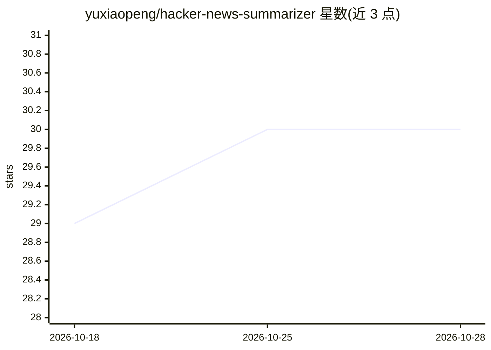

# yuxiaopeng/hacker-news-summarizer

⭐ 30 · Python · 推送 2026-10-27 · [GitHub](https://github.com/yuxiaopeng/hacker-news-summarizer) · [官网](https://yuxiaopeng.com/hacker-news-summarizer/) · 个人维护 · 中文 README

**Hacker News Top100 每日 AI 摘要中文翻译，自动更新**

仓库 README 本身即交付物：展示 Hacker News Top 10 文章的每日中文摘要（含原文标题、链接与要点提炼），完整 Top 100 通过链接提供，页面标注最后自动更新时间，并附 300 余天的历史日期归档。摘要由 Google Gemini API 生成并翻译为中文，每日自动更新，部分条目会标注“生成摘要时出错”。面向想用中文快速了解 Hacker News 内容的读者，非供安装运行的软件项目，README 未提供安装或使用说明。

## 筛选速览

| 维度 | 判定 | 备注 |
|---|---|---|
| AI 角色 | `ai-native` | 本体是模型或模型工具 |
| 许可风险 | `none` | — |
| 部署形态 | `None` |  |
| 模型依赖 | — | README 未给出锁定关系 |
| 硬件要求 | — | 无带数字的原话,不猜 |
| 安装摩擦 | `low` | 无编译、无系统依赖或容器化 |
| 成熟度 | — | 结构信号不足 |

## 能力要点

- 每日自动更新 Top 10 摘要，附 350+ 天历史归档表
- 条目包含原文标题、原文链接与中文摘要要点
- 摘要生成与翻译由 Google Gemini API 完成

## 适用场景

- 用中文快速浏览 Hacker News 当日热门内容
- 回溯查阅历史某天的 Hacker News 头条摘要
- 作为中文技术资讯日报订阅阅读

## 场景标签

`AI 写作` `精选清单` · 领域:内容生成

## 证据(README 行号)

> L3: 这是 Top 10 的每日摘要，更多请点击 Top 100
> L5: *最后自动更新时间: 2026-10-24 19:47:46*

## 星数曲线

2026-10-18 29 → 2026-10-28 30（+1）

---
*卡片 v1 · prompt 1.4 · 生成 2026-10-26 · 置信度 mid · 依据 README sha `438daec148c8` · [字段定义](../../DATASET.md)*
