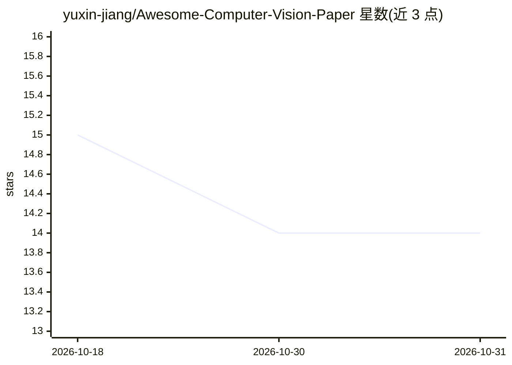

# yuxin-jiang/Awesome-Computer-Vision-Paper

⭐ 14 · 推送 2025-12-14 · [GitHub](https://github.com/yuxin-jiang/Awesome-Computer-Vision-Paper) · 个人维护

**计算机视觉论文分层分类清单：异常检测/生成/3D 等方向**

个人维护的计算机视觉论文策展仓库：以带编号的层级目录（大类→子类）组织异常检测、异常生成、扩散模型驱动的图像融合、视觉推理与 3D 视觉建模等方向。每个子类附研究方向说明（学术价值、生产价值、适用领域）及论文条目，条目含会议/期刊出处（CVPR 2025、ICCV 2025、AAAI 2026 等）、arXiv 链接与代码仓库链接（部分代码链接为占位符）。内容仅为目录，不含可运行代码或安装步骤。

## 筛选速览

| 维度 | 判定 | 备注 |
|---|---|---|
| AI 角色 | `ai-knowledge` | 知识聚合/清单类 |
| 许可风险 | `none` | — |
| 部署形态 | `None` |  |
| 模型依赖 | — | README 未给出锁定关系 |
| 硬件要求 | — | 无带数字的原话,不猜 |
| 安装摩擦 | `low` | 无编译、无系统依赖或容器化 |
| 成熟度 | — | 结构信号不足 |

## 能力要点

- 层级编号目录组织 5 个以上研究方向与细分子类
- 每篇论文附发表出处与 arXiv/代码链接
- 每个子类附研究动机说明（学术价值/生产价值/适用领域）
- 收录 2021-2026 年论文，含 AAAI 2026 等最新条目

## 适用场景

- 按子方向查找异常检测/异常生成领域的代表论文与代码
- 了解工业缺陷检测等方向的子课题划分
- 科研选题时浏览某方向的最新进展（2025-2026）

## 场景标签

`精选清单` · 领域:学习与行业

## 证据(README 行号)

> L1: # Awesome-Computer-Vision-Paper
> L9: - **1. Anomaly Detection**
> L43: - One Dinomaly2 Detect Them All: A Unified Framework for Full-Spectrum Unsupervised Anomaly Detection [[arXiv 2025]

## 星数曲线

2026-10-18 15 → 2026-10-31 14（-1）

---
*卡片 v1 · prompt 1.4 · 生成 2026-10-31 · 置信度 high · 依据 README sha `96af9abbde0d` · [字段定义](../../DATASET.md)*
