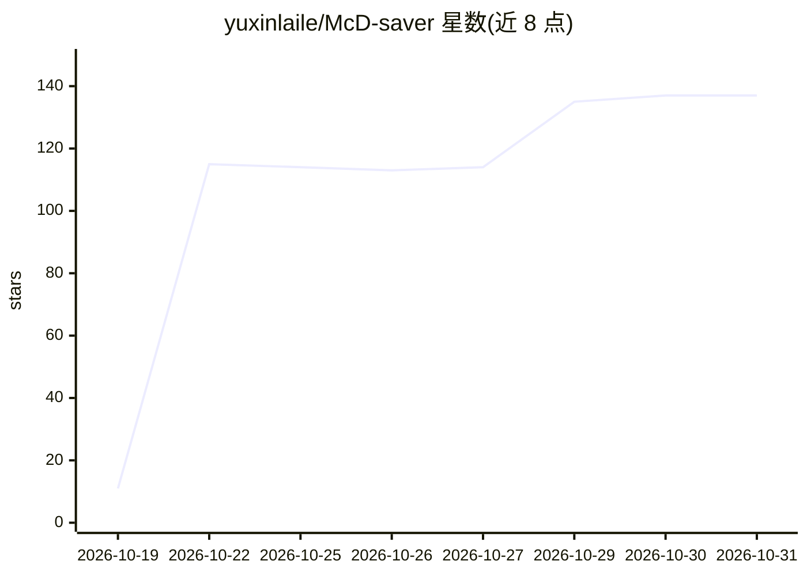

# yuxinlaile/McD-saver

⭐ 137 · Python · NOASSERTION · 推送 2026-10-23 · [GitHub](https://github.com/yuxinlaile/McD-saver) · [官网](https://yuxinlaile.github.io/McD-saver/demo.html) · 个人维护 · 中文 README

**麦当劳中国省钱点餐 Agent Skill 与独立 CLI**

面向麦当劳中国用户的省钱点餐工具，以 Agent Skill + CLI + 在线试算页三种形式提供：装进 Claude Code / Cursor / Codex / WorkBuddy 等客户端后，Agent 按 SKILL.md 自动执行领券、门店选券、无券/带券双价对比（官方 calculate-price）、积分抵扣评估四步检查；CLI 直连官方 MCP Server，另含券组合优化器（预算/热量/蛋白/钠四维约束）、美团/抖音团购手动录入比价与沉默成本体检。仅用 Python 标准库，需申请麦当劳 MCP Token，限中国大陆个人非商业用途。

## 筛选速览

| 维度 | 判定 | 备注 |
|---|---|---|
| AI 角色 | `ai-ecosystem` | LLM/agent 周边工具 |
| 许可风险 | `none` | NOASSERTION |
| 部署形态 | `library` | 以包/库形式分发 |
| 模型依赖 | — | README 未给出锁定关系 |
| 硬件要求 | — | 无带数字的原话,不猜 |
| 安装摩擦 | `low` | 无编译、无系统依赖或容器化 |
| 成熟度 | — | 结构信号不足 |

## 能力要点

- 四步省钱检查：领券→选券→官方 calculate-price 双价对比→积分评估
- 券组合优化器支持预算/热量/蛋白/钠四维约束，确定性枚举排名
- 美团/抖音团购券手动录入与全渠道同口径比价
- 沉默成本体检：临期券扫描、用券排程、积分影子价格

## 适用场景

- 下单前让 AI 帮我跑一遍领券和比价检查
- 比较官方券、团购券和积分兑换哪个终局更便宜
- 控制点餐预算同时满足热量和蛋白目标

## 场景标签

 · 领域:生活消费/点餐工具

## 证据(README 行号)

> L5: **让 AI 帮你用最少的钱吃麦当劳** —— Agent Skill + 独立 CLI 二合一
> L31: - **Agent Skill**：一份 `SKILL.md` 遵循开放标准，装进 WorkBuddy / Claude Code / Cursor / Codex 即用；
> L32: - **独立 CLI**：`scripts/mcd.py` 直连官方 MCP Server（M-China/mcd-mcp-server 集成指南），无需任何客户端；

## 星数曲线

2026-10-19 11 → 2026-10-31 137（+126）

---
*卡片 v1 · prompt 1.4 · 生成 2026-10-23 · 置信度 low · 依据 README sha `1c146b4014a0` · [字段定义](../../DATASET.md)*
