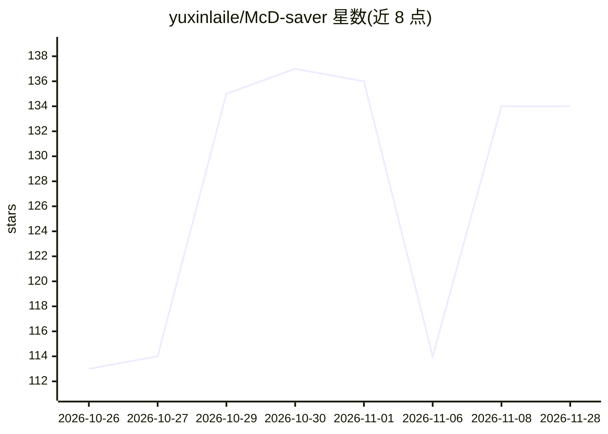

# yuxinlaile/McD-saver

⭐ 134 · Python · NOASSERTION · 推送 2026-10-23 · [GitHub](https://github.com/yuxinlaile/McD-saver) · [官网](https://yuxinlaile.github.io/McD-saver/demo.html) · 个人维护

**麦当劳中国点餐省钱 Agent Skill 与 CLI，下单前算最优用券**

以「省钱」为目标的麦当劳中国点餐决策工具，提供三种用法：遵循开放标准的 SKILL.md（装进 WorkBuddy/Claude Code/Cursor/Codex）、直连官方 MCP Server 的独立 CLI（scripts/mcd.py）、免登录在线试算页。核心机制为省钱四步检查（领券→选券→无券/带券双价对比→积分评估）、券组合确定性枚举优化、美团/抖音团购券手动录入同口径比价、沉默成本体检与多单用券排程。优惠金额均取自官方 calculate-price 返回值。限制：仅限中国大陆个人非商业用途，不含自动下单与定时领券。

## 筛选速览

| 维度 | 判定 | 备注 |
|---|---|---|
| AI 角色 | `ai-native` | 本体是模型或模型工具 |
| 许可风险 | `none` | NOASSERTION |
| 部署形态 | `library` | 以包/库形式分发 |
| 模型依赖 | — | README 未给出锁定关系 |
| 硬件要求 | — | 无带数字的原话,不猜 |
| 安装摩擦 | `low` | 无编译、无系统依赖或容器化 |
| 成熟度 | — | 结构信号不足 |

## 能力要点

- 官方 calculate-price 实测无券/带券双价对比，金额不虚构
- 券组合优化器支持预算/热量/蛋白/钠四维约束
- 美团/抖音团购券手动录入，与官方价同口径折算比价
- 沉默成本体检：临期券扫描与多单用券排程时间轴

## 适用场景

- 点麦当劳前让 Agent 自动跑一遍省钱检查再确认下单
- 把囤在美团/抖音的团购券与官方价同口径对比选便宜的买法
- 扫描临期券并排程到未来点单，避免券过期浪费
- 按预算和热量/蛋白/钠约束选套餐

## 场景标签

 · 领域:生活消费/点餐决策工具

## 证据(README 行号)

> L31: - **Agent Skill**：一份 `SKILL.md` 遵循开放标准，装进 WorkBuddy / Claude Code / Cursor / Codex 即用；
> L32: - **独立 CLI**：`scripts/mcd.py` 直连官方 MCP Server（M-China/mcd-mcp-server 集成指南），无需任何客户端；
> L57: - 领券前置 → 门店选券 → 无券/带券双价对比 → 积分抵扣评估

## 星数曲线

2026-10-26 113 → 2026-11-28 134（+21）

---
*卡片 v1 · prompt 1.4 · 生成 2026-11-28 · 置信度 mid · 依据 README sha `b512514d9ae9` · [字段定义](../../DATASET.md)*
