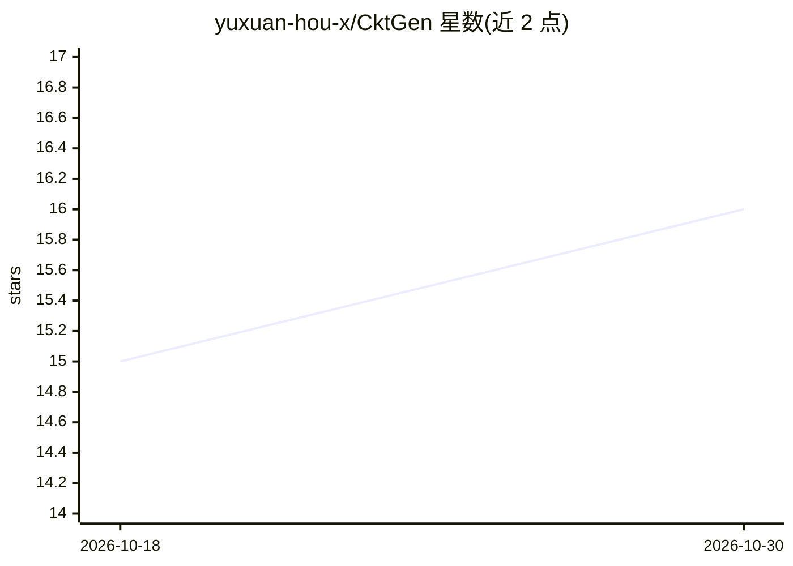

# yuxuan-hou-x/CktGen

⭐ 16 · Python · MIT · 推送 2026-07-20 · [GitHub](https://github.com/yuxuan-hou-x/CktGen) · 个人维护 · 中文 README

**按规格条件生成模拟电路的生成式 AI 研究代码**

论文《CktGen: Automated Analog Circuit Design with Generative Artificial Intelligence》的官方代码。将模拟电路综合表述为规格条件生成（Spec2Ckt）：给定目标规格直接生成电路，通过对比学习+分类器引导+特征对齐的三重对齐将规格与电路映射到共享潜空间，并用多臂老虎机在潜空间做免重训的测试时优化。基于 PyTorch 1.13.1/CUDA 11.7 的 conda 环境安装，仓库内置 OCB 数据集（含 Ckt-Bench-101），预训练模型从 Hugging Face 或百度网盘下载，提供 CktGNN/LDT/PACE/CVAEGAN 四个基线的复现与训练脚本。实验在 NVIDIA RTX 4090 上进行，建议 24GB+ 显存。

## 筛选速览

| 维度 | 判定 | 备注 |
|---|---|---|
| AI 角色 | `ai-native` | 本体是模型或模型工具 |
| 许可风险 | `permissive` | MIT |
| 部署形态 | `None` |  |
| 模型依赖 | — | README 未给出锁定关系 |
| 硬件要求 | — | 无带数字的原话,不猜 |
| 安装摩擦 | `medium` | 含编译或系统依赖之一 |
| 成熟度 | — | 结构信号不足 |

## 能力要点

- Spec 条件生成：给定目标规格直接生成电路，无需重复训练
- 多臂老虎机在潜空间中测试时优化以满足新规格
- 内置 OCB 数据集与预训练模型下载脚本，可复现论文结果
- 提供 CktGNN/LDT/PACE/CVAEGAN 四个基线的评测与训练脚本

## 适用场景

- 复现论文中模拟电路自动设计的实验结果
- 基于预训练模型按新规格生成候选电路设计
- 作为基线对比开展模拟电路生成方法研究

## 场景标签

 · 领域:EDA/模拟电路设计自动化

## 证据(README 行号)

> L10: We are the first to formulate analog circuit synthesis as **Spec-conditioned generation (Spec2Ckt)**: given a targe
> L12: - **New problem formulation.** The first to cast analog circuit synthesis as Spec-conditioned generation, moving be
> L13: - **One-to-many mapping via joint alignment.** Triple alignment (contrastive learning + classifier guidance + featu

## 星数曲线

2026-10-18 15 → 2026-10-30 16（+1）

---
*卡片 v1 · prompt 1.4 · 生成 2026-10-30 · 置信度 high · 依据 README sha `e6492cc18e5b` · [字段定义](../../DATASET.md)*
