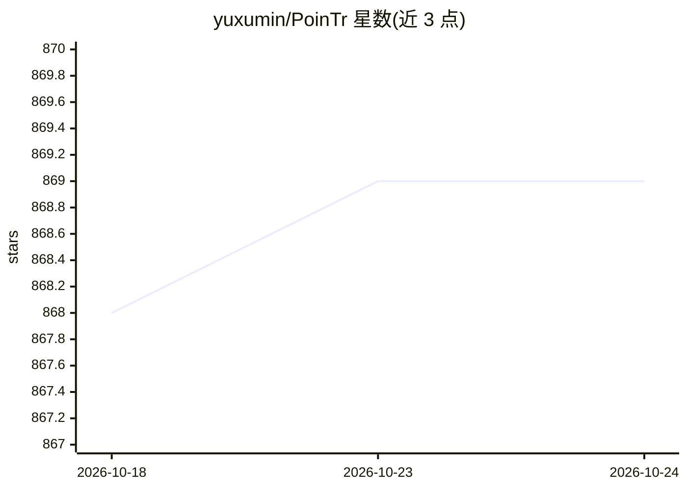

# yuxumin/PoinTr

⭐ 869 · Python · MIT · 推送 2026-06-24 · [GitHub](https://github.com/yuxumin/PoinTr) · 组织维护 · 中文 README

**基于 Transformer 的点云补全模型（ICCV 2021 Oral）**

PoinTr 是点云补全任务的 PyTorch 实现：将点云表示为带位置嵌入的无序点组序列，转为点代理（point proxies），用 transformer 编码器-解码器架构生成完整点云。面向三维视觉研究者，提供预训练模型（ShapeNet-55/34、PCN、KITTI）、推理/评测/训练脚本，并附带 GRNet、PCN、TopNet、FoldingNet 等基线实现；另提出更贴近真实场景的 ShapeNet-55/34 基准。需编译 Chamfer Distance、PointNet++、kNN 的 PyTorch 扩展，要求 CUDA >= 9.0、GCC >= 4.9。

## 筛选速览

| 维度 | 判定 | 备注 |
|---|---|---|
| AI 角色 | `ai-native` | 本体是模型或模型工具 |
| 许可风险 | `permissive` | MIT |
| 部署形态 | `library` | 以包/库形式分发 |
| 模型依赖 | — | README 未给出锁定关系 |
| 硬件要求 | — | 无带数字的原话,不猜 |
| 安装摩擦 | `high` | 编译与系统依赖俱全 |
| 成熟度 | — | 结构信号不足 |

## 能力要点

- transformer 编码器-解码器生成完整点云
- 提供 ShapeNet-55/34、PCN、KITTI 预训练模型
- 附 GRNet/PCN/TopNet/FoldingNet 基线实现
- 支持 DDP 多卡训练与断点续训

## 适用场景

- 对残缺点云进行补全重建
- 在 ShapeNet/PCN/KITTI 基准上评测或复现结果
- 作为点云补全研究的基线进行训练与微调

## 场景标签

 · 领域:三维计算机视觉/深度学习

## 证据(README 行号)

> L9: This repository contains PyTorch implementation for __PoinTr: Diverse Point Cloud Completion with Geometry-Aware Tra
> L11: PoinTr is a transformer-based model for point cloud completion. By representing the point cloud as a set of unorder

## 星数曲线

2026-10-18 868 → 2026-10-24 869（+1）

---
*卡片 v1 · prompt 1.4 · 生成 2026-10-21 · 置信度 high · 依据 README sha `e90d38ed5930` · [字段定义](../../DATASET.md)*
