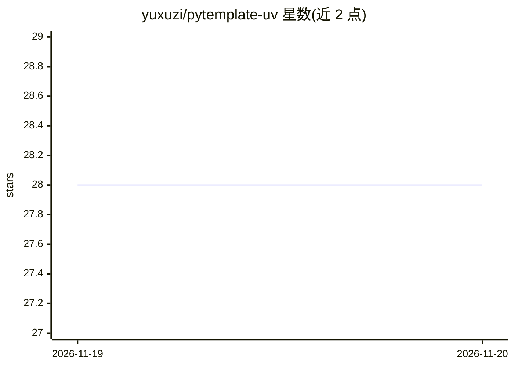

# yuxuzi/pytemplate-uv

⭐ 28 · Python · MIT · 推送 2026-11-17 · [GitHub](https://github.com/yuxuzi/pytemplate-uv) · 个人维护

**面向 Python 开发者的 uv 项目脚手架生成器**

一个生成 Python 项目模板的 CLI 工具：基于 uv 包管理器，通过 profile（Python CLI 库或 FastAPI 服务）加可选组件（数据库、认证、后台任务、Docker、MCP server 等）生成标准化项目结构，生成物自带 lint/类型检查/测试并通过 CI 验证 28 种组件组合。生成是确定性的，支持 plan 预览、TOML 请求文件复现、--json 输出与退出码约定，并可通过模板包扩展。提供 agent skill 与 AGENTS.md 生成以便 AI 编码代理使用。

## 筛选速览

| 维度 | 判定 | 备注 |
|---|---|---|
| AI 角色 | `ai-enhanced` | 去掉 AI 部分产品仍成立 |
| 许可风险 | `permissive` | MIT |
| 部署形态 | `self-host` | docker 或自建部署 |
| 模型依赖 | — | README 未给出锁定关系 |
| 硬件要求 | — | 无带数字的原话,不猜 |
| 安装摩擦 | `low` | 无编译、无系统依赖或容器化 |
| 成熟度 | — | 结构信号不足 |

## 能力要点

- 确定性生成：相同请求产出字节相同的项目
- 3 种 profile 与 8 种组件自由组合，生成前校验
- 每个生成项目附带 AGENTS.md 与可选 MCP server 组件
- plan/validate 不写文件，支持模板包（template pack）扩展与 pin 版本

## 适用场景

- 启动新的 FastAPI 服务或带 CLI 的类型化包时生成标准化骨架
- 在 CI 流水线中用脚本化命令批量生成项目
- 给 AI 编码代理提供一个可校验的脚手架步骤
- 为代理生成可调用的 MCP server 工具项目

## 场景标签

`代码生成` · 领域:编码与开发

## 证据(README 行号)

> L11: A modern application factory that generates **uv-native** Python projects. With the bundled
> L42: |`mcp`|An MCP server over stdio, with a typed tool, a test, and `.mcp.json` (`python` and `library` profiles)|To gi
> L250: ## Built for AI coding agents

## 星数曲线

2026-11-19 28 → 2026-11-20 28（+0）

---
*卡片 v1 · prompt 1.4 · 生成 2026-11-19 · 置信度 mid · 依据 README sha `3a3aa68a6ce2` · [字段定义](../../DATASET.md)*
