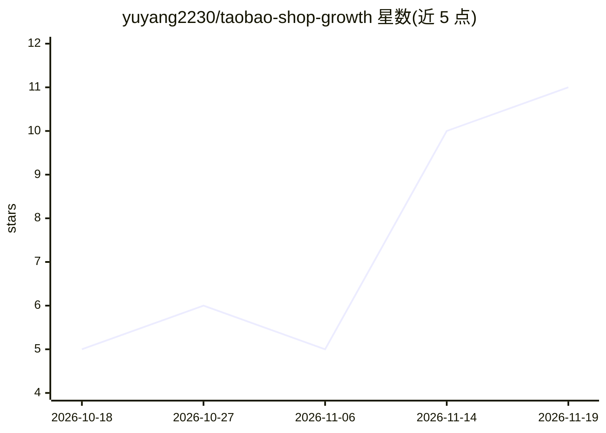

# yuyang2230/taobao-shop-growth

⭐ 11 · MIT · 推送 2026-11-12 · [GitHub](https://github.com/yuyang2230/taobao-shop-growth) · [官网](https://yuyang2230.github.io/taobao-shop-growth/) · 个人维护 · 中文 README

**淘宝个人小店获客优化的 AI 技能包与 SOP 库**

把一家真实在营的淘宝 C 店获客优化流程写成 AI 可执行的 SOP 技能：覆盖店铺诊断、商品标题与必填属性提分、逛逛图文与商品视频内容产出、浏览器/CDP 自动化批量操作等。技能文件放入 Claude Code / ZCode 等编程助手的技能目录即可使用；也可作为人工操作手册直接按 references/ 执行。README 附 10 条实测发现、版本记录与单店案例（实验室仪器类目），方法来自特定类目单店经验。

## 筛选速览

| 维度 | 判定 | 备注 |
|---|---|---|
| AI 角色 | `ai-knowledge` | 知识聚合/清单类 |
| 许可风险 | `permissive` | MIT |
| 部署形态 | `None` |  |
| 模型依赖 | — | README 未给出锁定关系 |
| 硬件要求 | — | 无带数字的原话,不猜 |
| 安装摩擦 | `low` | 无编译、无系统依赖或容器化 |
| 成熟度 | — | 结构信号不足 |

## 能力要点

- 诊断/标题/属性/内容/自动化五模块 SOP 与模板库
- 浏览器 Agent + CDP 直连双通道自动化批量改标题补属性
- 主图免拍摄产出商品视频管线，含 OCR 质检兜底
- 站内 AI 搜索（千问）摘引结构的 GEO 优化方法

## 适用场景

- 给一家没时间学运营的淘宝小店做整体诊断与商品优化
- 用 AI Agent 批量改标题、补必填属性防流量受限
- 批量生成逛逛图文与商品视频做站内引流
- 在千牛后台把重复性操作交给自动化流程

## 场景标签

`浏览器自动化` `视频生成` `OCR` · 领域:效率与自动化

## 证据(README 行号)

> L12: 这个仓库把一家小店的日常获客优化拆成了 AI 能照做的 SOP（标准操作流程），装进 Claude Code / ZCode / Cursor 这类 AI 编程助手的技能目录就能用。你只需要说一句"帮我优化全店商品"，剩下的诊断、
> L52: ├── SKILL.md                     # 主技能文件（AI 的操作指令）

## 星数曲线

2026-10-18 5 → 2026-11-19 11（+6）

---
*卡片 v1 · prompt 1.4 · 生成 2026-11-19 · 置信度 high · 依据 README sha `bd8c1fc2d329` · [字段定义](../../DATASET.md)*
