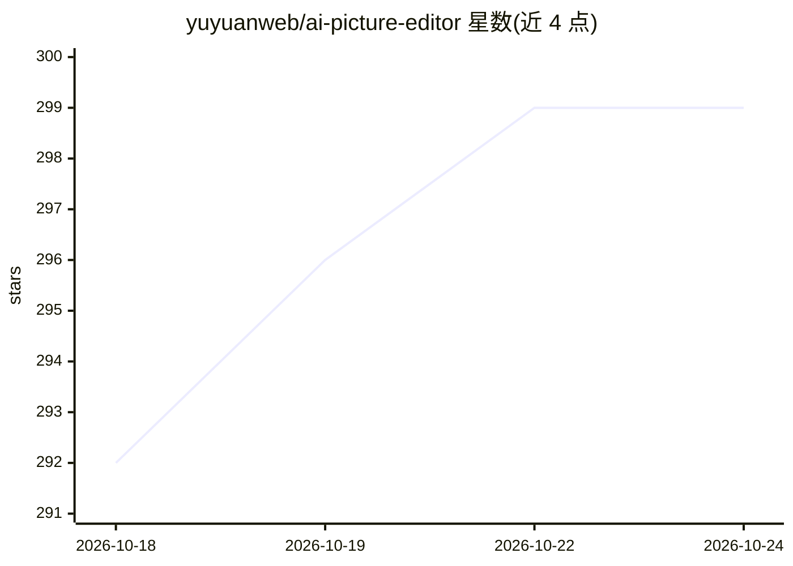

# yuyuanweb/ai-picture-editor

⭐ 300 · Python · 推送 2026-09-16 · [GitHub](https://github.com/yuyuanweb/ai-picture-editor) · [官网](https://www.codefather.cn/course/2099386518517915649) · 组织维护 · 中文 README

**编程导航付费教程项目：AI Agent 驱动的全栈修图应用**

编程导航的教学项目仓库，提供一套前后端分离的 AI 修图智能体源码与配套教程：前端 React 19 + Konva 画布编辑器，后端 Python 3.13 + FastAPI，LangChain 接入规划模型、LangGraph 编排 Agent，ToolRegistry 统一注册 21 种编辑工具供 UI 与 Agent 共用。能力覆盖文生图、SAM 点选选区、局部 inpainting、图层拆分、多步计划校验与拓扑排序执行，耗时任务走 ARQ 异步队列并经 Redis Pub/Sub + SSE 推送进度。依赖 Docker/Python/Node.js 环境与可选的阿里云百炼 API Key 本地运行；教程、简历写法与答疑需付费加入编程导航会员获取。

## 筛选速览

| 维度 | 判定 | 备注 |
|---|---|---|
| AI 角色 | `ai-native` | 本体是模型或模型工具 |
| 许可风险 | `none` | — |
| 部署形态 | `self-host` | docker 或自建部署 |
| 模型依赖 | — | README 未给出锁定关系 |
| 硬件要求 | — | 无带数字的原话,不猜 |
| 安装摩擦 | `low` | 无编译、无系统依赖或容器化 |
| 成熟度 | — | 结构信号不足 |

## 能力要点

- 自然语言驱动修图：Agent 规划步骤并调用 21 种编辑工具
- SAM 点选与笔刷选区、局部消除/替换（inpainting）、图层拆分独立操作
- 多步计划含服务端校验、拓扑排序与用户确认/单步重试
- ARQ 异步队列 + Redis Pub/Sub + SSE 实时进度推送

## 适用场景

- 跟随教程从 0 搭建 AI Agent 全栈应用并写进简历
- 用自然语言指令完成抠图、调色、换背景等修图操作
- 学习 FastAPI + LangGraph Agent + Canvas 画布引擎的架构组合

## 场景标签

`教程课程` `图像生成` · 领域:内容生成

## 证据(README 行号)

> L9: 这是一套以 **AI Agent 驱动的图片编辑** 为核心的全栈项目教程，基于 Python 3.13 + FastAPI + LangChain + LangGraph + React 19 + Konva。你只需要输入一句话，
> L96: 后端内部按照路由层、业务服务层、数据访问层分层，AI 生图、抠图、扩图等耗时任务通过 ARQ 异步队列提交到独立 Worker 执行，结果通过 Redis Pub/Sub + SSE 实时推送给前端。LangChain 负责接入规

## 星数曲线

2026-10-18 292 → 2026-10-24 299（+7）

---
*卡片 v1 · prompt 1.4 · 生成 2026-10-21 · 置信度 high · 依据 README sha `da6e18812c00` · [字段定义](../../DATASET.md)*
