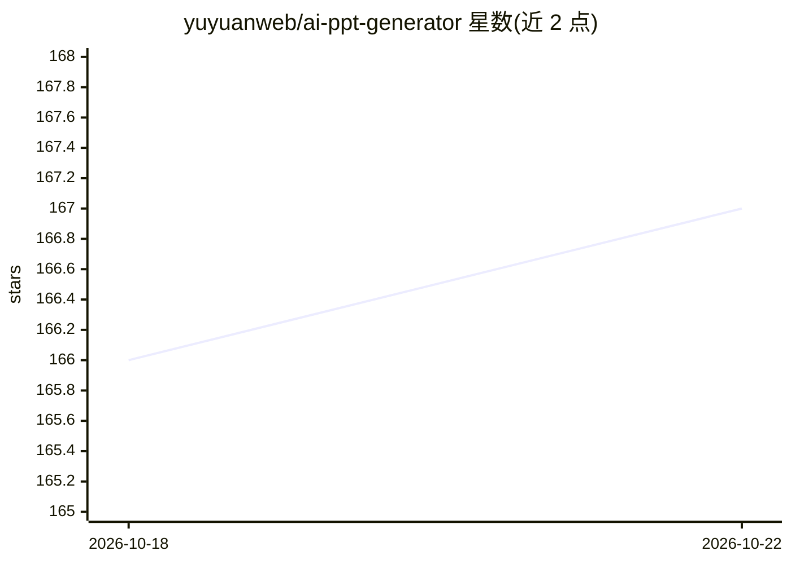

# yuyuanweb/ai-ppt-generator

⭐ 167 · Python · 推送 2026-09-16 · [GitHub](https://github.com/yuyuanweb/ai-ppt-generator) · [官网](https://www.codefather.cn/course/2091823677833220098) · 组织维护 · 中文 README

**给开发学习者的 AI PPT 生成器全栈项目教程（含完整源码）**

基于 FastAPI + LangChain + LangGraph + python-pptx + React 的 AI PPT 生成器教学项目：用户输入主题、长文本或上传 PDF/Word/Markdown/TXT，先产出可编辑大纲，再经 ARQ + Redis 异步并发生成页面，通过 SSE 推送进度，支持在线编辑器、AI 修改、多主题切换，最终经质量检查导出原生可编辑 PPTX。需 DeepSeek API Key（必需），OpenAI/阿里云百炼为可选生图后端。以付费教程（编程导航）形式提供源码、视频与文字教程。

## 筛选速览

| 维度 | 判定 | 备注 |
|---|---|---|
| AI 角色 | `ai-native` | 本体是模型或模型工具 |
| 许可风险 | `none` | — |
| 部署形态 | `self-host` | docker 或自建部署 |
| 模型依赖 | locked-api |  |
| 硬件要求 | — | 无带数字的原话,不猜 |
| 安装摩擦 | `low` | 无编译、无系统依赖或容器化 |
| 成熟度 | — | 结构信号不足 |

## 能力要点

- 主题/长文本/文档三入口生成，大纲先出、可增删改后排版
- ARQ Worker 页级并发生成 + Redis pub/sub + SSE 实时进度，支持单页重试与软取消
- python-pptx 导出原生可编辑 PPTX，FontTools 字形级溢出检测与 error/warning 分级门禁
- 内容/布局/主题三分离数据模型，Web 预览与 PPTX 导出同源渲染

## 适用场景

- 输入一句话主题或上传文档快速生成可编辑的 PPT
- 在在线编辑器中修改生成结果并用 AI 调整页面
- 学习 AI 工程化全流程（结构化输出、异步编排、文档渲染）以充实简历

## 场景标签

 · 领域:AI 应用/文档生成

## 证据(README 行号)

> L9: 这是一套以 **AI 工程化 + 文档渲染 + 异步任务编排** 为核心的全栈项目教程，基于 FastAPI + LangChain + LangGraph + python-pptx + React 开发。用户只需要输入一句主题、
> L90: - 一个 DeepSeek API Key（✅ 必需，用于 AI 生成大纲和页面）

## 星数曲线

2026-10-18 166 → 2026-10-22 167（+1）

---
*卡片 v1 · prompt 1.4 · 生成 2026-10-22 · 置信度 mid · 依据 README sha `921991571fe4` · [字段定义](../../DATASET.md)*
