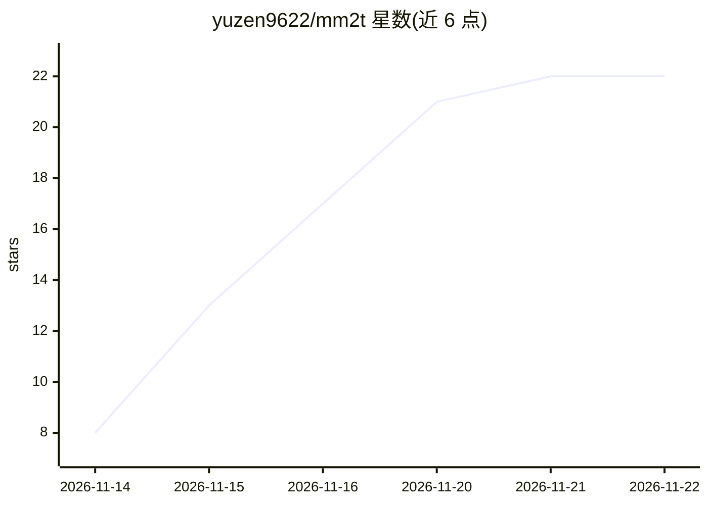

# yuzen9622/mm2t

⭐ 22 · Swift · NOASSERTION · 推送 2026-11-21 · [GitHub](https://github.com/yuzen9622/mm2t) · [官网](https://mm2t.yuzen.dev/en) · 个人维护 · 中文 README

**macOS 菜单栏多方会议录制与说话人标注转录工具**

驻留 Mac 菜单栏的会议记录应用：检测 Google Meet/Teams/Zoom/Webex 会议开始，分别录制本机麦克风与对方音轨，在本机运行说话人声纹识别并自动标注姓名。每次会议生成四种视图：带说话人标签的转录、去除语气词的整理稿、按人归纳的要点、含时间戳的决议与行动项摘要。转录与摘要使用用户自备的 ElevenLabs 与 Google Gemini API key，也支持自托管 faster-whisper 转录服务器；数据存储在本机，应用自身无服务器。要求 macOS 14.2 及以上，DMG 安装，当前版本未经 Apple 签名公证，需手动放行，且不自动更新。

## 筛选速览

| 维度 | 判定 | 备注 |
|---|---|---|
| AI 角色 | `ai-native` | 本体是模型或模型工具 |
| 许可风险 | `none` | NOASSERTION |
| 部署形态 | `desktop` | 安装包/桌面程序 |
| 模型依赖 | — | README 未给出锁定关系 |
| 硬件要求 | — | 无带数字的原话,不猜 |
| 安装摩擦 | `low` | 无编译、无系统依赖或容器化 |
| 成熟度 | `idea` | |

## 能力要点

- 本机声纹识别，命名一次后自动标注说话人
- 麦克风与通话对方分轨录制，无需机器人入会
- 生成转录/整理稿/按人要点/摘要四种视图，摘要含时间戳行动项
- 支持自托管 Breeze-ASR-25 (faster-whisper) 转录服务器，Docker 镜像部署

## 适用场景

- 开会时自动录制并生成带说话人姓名的会议纪要
- 会后会按标题、内容或参与者检索历史会议
- 数据不出本机、用自有 API key 做会议转录与摘要

## 场景标签

`语音识别` · 领域:感知与多模态

## 证据(README 行号)

> L9:  A meeting recorder that lives in your Mac's menu bar. It detects meetings, records them, and turns them into speake
> L26: Your microphone and the other side of the call are recorded on separate tracks. Speaker identification then runs lo
> L88: - **ElevenLabs** (speech to text): Create an API key at ElevenLabs with Speech to Text permission and sufficient cr

## 星数曲线

2026-11-14 8 → 2026-11-22 22（+14）

---
*卡片 v1 · prompt 1.4 · 生成 2026-11-18 · 置信度 high · 依据 README sha `121117bf7492` · [字段定义](../../DATASET.md)*
