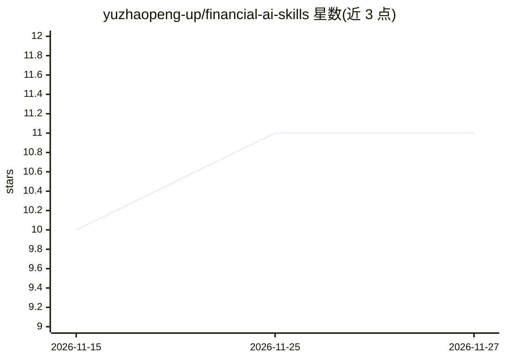

# yuzhaopeng-up/financial-ai-skills

⭐ 11 · Python · MIT · 推送 2026-08-02 · [GitHub](https://github.com/yuzhaopeng-up/financial-ai-skills) · 个人维护 · 中文 README

**金融/财富/风控场景的 104 个纯 Python AI 技能集**

面向银行保险行业的技能集合，按 6 财务+8 财富+9 风控等模块组织 104 个技能：发票查验、预算管控、财报速读、税务筹划、资金预测、资产配置、信用评级、反欺诈等。全部为纯规则引擎实现，不调用外部 API，仅依赖 Python 标准库，本地计算平均响应小于 100ms，输出适配企业 IM 的 Markdown 表格。通过 git clone 获取后以 Python API 调用，内置模拟演示数据。

## 筛选速览

| 维度 | 判定 | 备注 |
|---|---|---|
| AI 角色 | `ai-native` | 本体是模型或模型工具 |
| 许可风险 | `permissive` | MIT |
| 部署形态 | `library` | 以包/库形式分发 |
| 模型依赖 | — | README 未给出锁定关系 |
| 硬件要求 | — | 无带数字的原话,不猜 |
| 安装摩擦 | `low` | 无编译、无系统依赖或容器化 |
| 成熟度 | — | 结构信号不足 |

## 能力要点

- 104 个技能覆盖财务、财富、风控、营销等 7 个模块，均已发布
- 纯规则引擎，零 API 费用，仅依赖 Python 标准库
- 本地计算毫秒级响应，内置 mock 演示数据
- 输出为原生 Markdown 表格，适配 WeCom/飞书/钉钉

## 适用场景

- 高频场景下的发票真伪查验与预算超支预警
- 企业风险评估与信贷、反欺诈等风控检查
- 资产配置、退休与教育金规划等财富管理建议
- 销售话术生成与产品手册问答（BM25+TF-IDF RAG）

## 场景标签

`RAG` · 领域:知识与检索

## 证据(README 行号)

> L18: - **Zero API Cost**: Pure rule engines, no external API calls, ideal for high-frequency scenarios
> L72: |financial-intelligence|6|Invoice verification, Budget control, Financial report, Tax planning, Expense audit, Cash

## 星数曲线

2026-11-15 10 → 2026-11-27 11（+1）

---
*卡片 v1 · prompt 1.4 · 生成 2026-11-19 · 置信度 low · 依据 README sha `12632318c4ee` · [字段定义](../../DATASET.md)*
