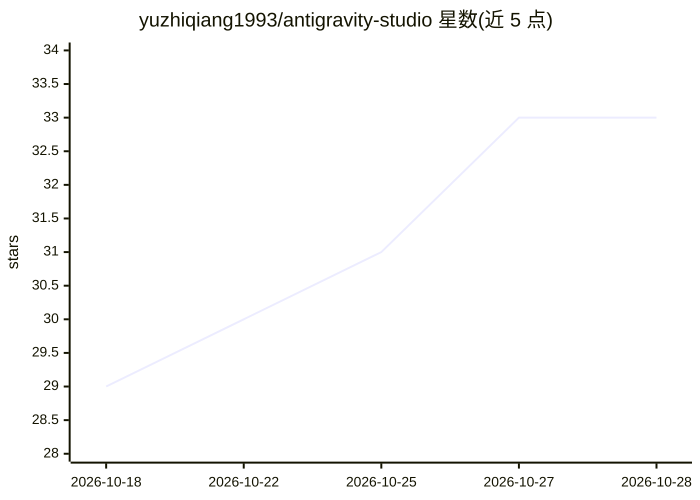

# yuzhiqiang1993/antigravity-studio

⭐ 35 · MIT · 推送 2026-10-14 · [GitHub](https://github.com/yuzhiqiang1993/antigravity-studio) · 个人维护 · 中文 README

**Antigravity 多账号管理与模型代理桌面客户端**

面向 Google Antigravity（IDE/桌面端/CLI/VS Code 插件）用户的跨平台桌面客户端：将多个 Google 账号放入本地代理池自动调度，提供故障转移、重置优先、粘性会话、负载均衡等策略，应对 429 限流与配额浪费；同时通过 BYOK 接入 34+ 平台的第三方模型（含思考链解析与自定义上下文长度），并提供跨端会话整理、本地用量统计与调用日志。所有请求本地直连，不经过第三方中转。macOS/Windows 提供安装包。

## 筛选速览

| 维度 | 判定 | 备注 |
|---|---|---|
| AI 角色 | `ai-ecosystem` | LLM/agent 周边工具 |
| 许可风险 | `permissive` | MIT |
| 部署形态 | `desktop` | 安装包/桌面程序 |
| 模型依赖 | local-ok | 支持本地模型 |
| 硬件要求 | — | 无带数字的原话,不猜 |
| 安装摩擦 | `low` | 无编译、无系统依赖或容器化 |
| 成熟度 | — | 结构信号不足 |

## 能力要点

- 多账号池化调度：故障转移/重置优先/粘性会话/负载均衡四种策略
- BYOK 接入 34+ 平台预设（OpenAI、Anthropic、Gemini、DeepSeek、Ollama、OpenRouter 等）
- 支持 DeepSeek 思考链流式输出、工具调用与自定义上下文长度
- 一键接管编辑器代理、跨端历史会话统一管理与 AI 智能起名

## 适用场景

- 多个 Google 账号配额轮换，避免单号被限流
- 在 Antigravity 里直接使用 DeepSeek、Claude 或本地 Ollama 模型
- 统一查看 IDE、桌面端、CLI 各客户端的历史会话与 Token 用量

## 场景标签

`模型网关` · 领域:Agent 开发

## 证据(README 行号)

> L10: Antigravity Studio 是为 Antigravity（包括 IDE 编辑器、桌面端、终端 CLI 和 VS Code 插件）做的一款多账号管理与大模型代理工具。
> L12: 平时用 Antigravity 写代码，账号多了换号麻烦，高频调用又容易撞上 429 限流，想用 DeepSeek、Claude 或本地模型也接不进来。这个工具就是为了解决这些日常痛点写的：把多个 Google 账号放到一个池子里
> L47: - **内置 34+ 平台预设**：OpenAI、Anthropic、Gemini、DeepSeek、Ollama、OpenRouter、Magpie、硅基流动、阿里云百炼、Kimi、智谱等，填上 API Key 就能用。

## 星数曲线

2026-10-18 29 → 2026-10-28 33（+4）

---
*卡片 v1 · prompt 1.4 · 生成 2026-10-26 · 置信度 high · 依据 README sha `e1c7f9ca00c7` · [字段定义](../../DATASET.md)*
