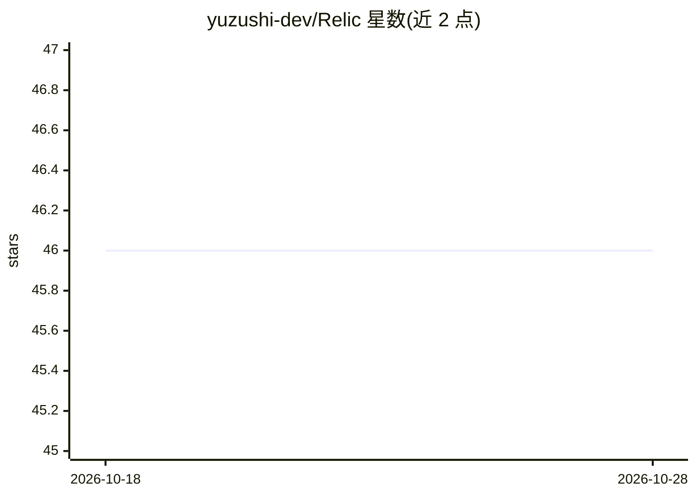

# yuzushi-dev/Relic

⭐ 46 · Python · AGPL-3.0 · 推送 2026-07-28 · [GitHub](https://github.com/yuzushi-dev/Relic) · [官网](https://yuzushi-dev.github.io/Relic/) · 组织维护

**为反思型 agent 提供纵向关系建模与运行时治理层**

面向反思型 agent 的运行时治理与纵向建模层：从对话交互中采集行为信号，维护可演化的 subject profile（基于依恋理论、评价理论等派生的特质维度，每个特质带置信度与观测计数），并在隐私、纠正与溯源约束下生成可检视的运行时上下文。配套生成关系型 agent Gumi。通过 git clone 源码与 pip install -e 安装，CLI 初始化；relic init 会安装并配置 Ollama。自我声明为 OSS Alpha，评估门控当前 3/7 满足，发布被设计性阻断。

## 筛选速览

| 维度 | 判定 | 备注 |
|---|---|---|
| AI 角色 | `ai-ecosystem` | LLM/agent 周边工具 |
| 许可风险 | `viral` | AGPL-3.0 |
| 部署形态 | `library` | 以包/库形式分发 |
| 模型依赖 | local-ok | 支持本地模型 |
| 硬件要求 | — | 无带数字的原话,不猜 |
| 安装摩擦 | `low` | 无编译、无系统依赖或容器化 |
| 成熟度 | `idea` | |

## 能力要点

- 从对话交互捕获行为信号并维护可演化的 subject profile
- 特质维度源自心理学理论框架，带置信度与观测计数
- 隐私分阶段、证据溯源与纠正/审计工作流
- 机器可读的 Evidence Sufficiency Gate（当前 3/7，发布被阻断）

## 适用场景

- 为长期陪伴/关系型 agent 维护随时间演化的用户画像
- 在隐私与溯源约束下检视和纠正 agent 对用户的推断
- 研究纵向行为建模的可检视实验平台

## 场景标签

`Agent 记忆` · 领域:Agent 开发

## 证据(README 行号)

> L25: Relic is a runtime governance and longitudinal modeling layer for reflective
> L27: interaction, maintain evolving subject profiles, and produce inspectable runtime

## 星数曲线

2026-10-18 46 → 2026-10-28 46（+0）

---
*卡片 v1 · prompt 1.4 · 生成 2026-10-25 · 置信度 high · 依据 README sha `d4d63c487ddf` · [字段定义](../../DATASET.md)*
