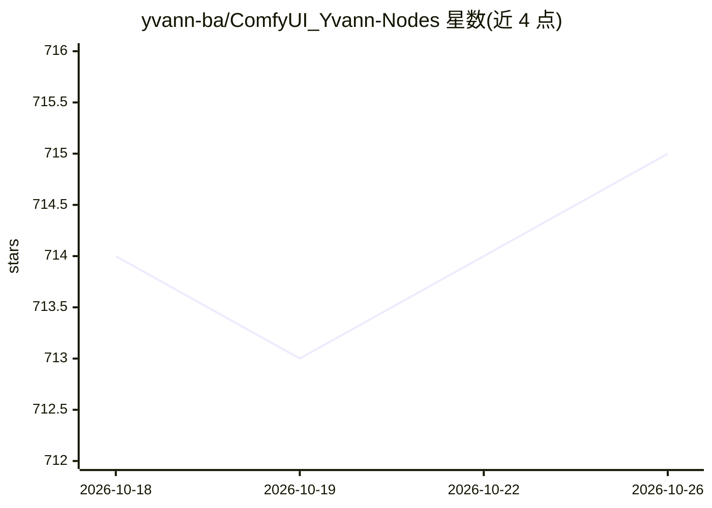

# yvann-ba/ComfyUI_Yvann-Nodes

⭐ 715 · Python · GPL-3.0 · 推送 2026-02-21 · [GitHub](https://github.com/yvann-ba/ComfyUI_Yvann-Nodes) · [官网](https://youtube.com/@yvann_ba) · 个人维护

**ComfyUI 音频反应节点包：生成随音乐同步的 AI 动画**

ComfyUI 的自定义节点包，提供音频分析、音源分离、峰值检测、IPAdapter 转场调度、提示词调度与混音等节点，用于生成随音频联动的 AI 动画。提供图生视频、视频转视频、文生视频三类预置工作流（JSON 文件拖入 ComfyUI 安装运行），兼容 IPAdapter、AnimateDiff、ControlNet 等现有节点。音频分离支持 HybridDemucs 与 OpenUnmix 模型。使用者需先安装 ComfyUI（Mac/Windows/Linux 均可），并下载工作流中列出的模型。

## 筛选速览

| 维度 | 判定 | 备注 |
|---|---|---|
| AI 角色 | `ai-ecosystem` | LLM/agent 周边工具 |
| 许可风险 | `viral` | GPL-3.0 |
| 部署形态 | `None` |  |
| 模型依赖 | — | README 未给出锁定关系 |
| 硬件要求 | — | 无带数字的原话,不猜 |
| 安装摩擦 | `low` | 无编译、无系统依赖或容器化 |
| 成熟度 | — | 结构信号不足 |

## 能力要点

- 音频分析生成逐帧反应权重，支持仅鼓点/人声/全音频模式
- 音源分离模型（HybridDemucs/OpenUnmix）加载与音轨混音节点
- 峰值检测驱动 IPAdapter 图像转场与提示词调度
- 提供 ImagesToVideo/VideoToVideo/TextToVideo 三类预置工作流

## 适用场景

- 为音乐制作随节拍切换图像或风格的 AI 动画视频
- 在 ComfyUI 中将音频要素（鼓点/人声/低音）映射为生成控制信号
- 基于已有视频或图片集合成音频驱动的二创内容

## 场景标签

`视频生成` `图像生成` · 领域:内容生成

## 证据(README 行号)

> L1: ### **A pack of custom nodes that enable audio reactivity within ComfyUI, allowing you to generate AI-driven animati
> L7: - **Flexible**: Works with existing ComfyUI AI tech and nodes (eg: IPAdapter, AnimateDiff, ControlNet, etc.)

## 星数曲线

2026-10-18 714 → 2026-10-26 715（+1）

---
*卡片 v1 · prompt 1.4 · 生成 2026-10-21 · 置信度 high · 依据 README sha `782dcbabd4e3` · [字段定义](../../DATASET.md)*
