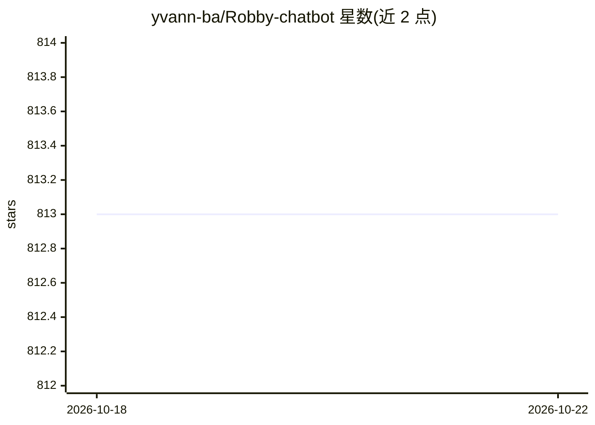

# yvann-ba/Robby-chatbot

⭐ 813 · Python · Apache-2.0 · 推送 2026-02-21 · [GitHub](https://github.com/yvann-ba/Robby-chatbot) · [官网](https://robby-chatbot.streamlit.app/) · 个人维护

**与 CSV/PDF/TXT 文件及 YouTube 视频对话的开源聊天机器人**

基于 Streamlit 构建的本地运行聊天应用，提供三个功能：对 PDF/TXT/CSV 文档进行带对话记忆的问答（LangChain 编排、FAISS 向量检索）、用 PandasAI 以自然语言分析表格数据、以及用 AI 总结 YouTube 视频。模型接入 OpenAI API（GPT-4o/GPT-4o-mini/GPT-4-turbo/GPT-3.5-turbo），需提供 OpenAI API key。通过 git clone 源码、虚拟环境与 pip 安装依赖后以 streamlit run 启动，无 Docker 或安装包形式。

## 筛选速览

| 维度 | 判定 | 备注 |
|---|---|---|
| AI 角色 | `ai-native` | 本体是模型或模型工具 |
| 许可风险 | `permissive` | Apache-2.0 |
| 部署形态 | `library` | 以包/库形式分发 |
| 模型依赖 | — | README 未给出锁定关系 |
| 硬件要求 | — | 无带数字的原话,不猜 |
| 安装摩擦 | `low` | 无编译、无系统依赖或容器化 |
| 成熟度 | — | 结构信号不足 |

## 能力要点

- 对 CSV/PDF/TXT 文档的带对话记忆问答（向量嵌入+FAISS）
- PandasAI 自然语言分析表格数据
- AI 总结 YouTube 视频内容
- 支持 4 种 OpenAI 模型切换，GPT-4o-mini 为默认

## 适用场景

- 上传自己的文档并通过对话提问获取回答
- 不写代码用自然语言分析表格数据
- 快速获取 YouTube 视频的内容摘要

## 场景标签

 · 领域:对话式 AI 应用

## 证据(README 行号)

> L14: - **Robby-Chat**: Chat with your documents (PDF, TXT, CSV) using vector embeddings and conversational memory
> L21: - **OpenAI** - GPT-4o, GPT-4o-mini, GPT-4-turbo, GPT-3.5-turbo

## 星数曲线

2026-10-18 813 → 2026-10-22 813（+0）

---
*卡片 v1 · prompt 1.4 · 生成 2026-10-21 · 置信度 mid · 依据 README sha `6ac345006c9e` · [字段定义](../../DATASET.md)*
