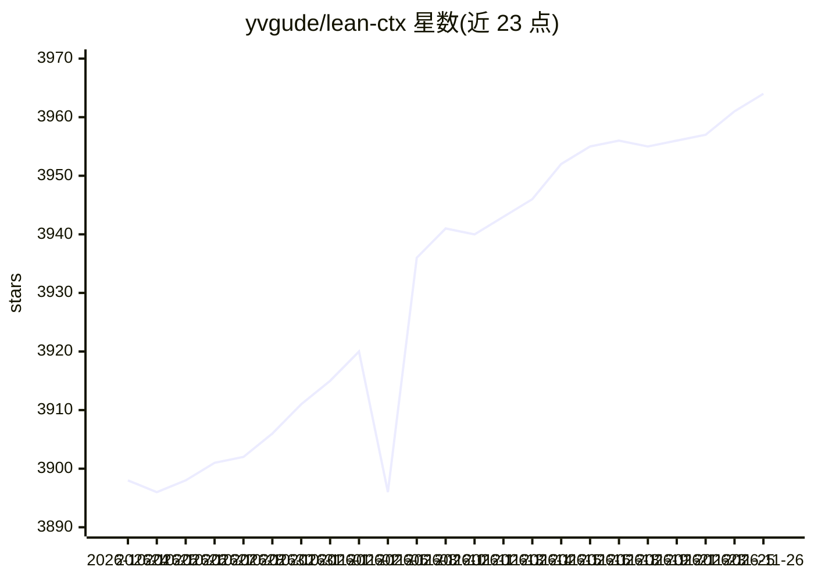

# yvgude/lean-ctx

⭐ 3,964 · Rust · Apache-2.0 · 推送 2026-11-25 · [GitHub](https://github.com/yvgude/lean-ctx) · [官网](https://leanctx.com) · 组织维护

**AI 工具的上下文网关：按任务选上下文、控访问、留证据**

定位在 AI 工具与其读取信息之间的本地网关：对文件读取和 shell 输出做选择（16 种读模式、85+ shell 压缩模式、tree-sitter AST 结构视图）、按配置施加路径权限与内容过滤等控制、跨会话保存任务/事实/决策记录，并导出可核查的审计证据。开源 OSS 部分通过 CLI、MCP、hooks 与代理路径本地运行，另提供 SDK；企业范围的控制与部署按许可提供。README 明确性能节省声明为立场而非实测结果。

## 筛选速览

| 维度 | 判定 | 备注 |
|---|---|---|
| AI 角色 | `ai-ecosystem` | LLM/agent 周边工具 |
| 许可风险 | `permissive` | Apache-2.0 |
| 部署形态 | `library` | 以包/库形式分发 |
| 模型依赖 | — | README 未给出锁定关系 |
| 硬件要求 | — | 无带数字的原话,不猜 |
| 安装摩擦 | `low` | 无编译、无系统依赖或容器化 |
| 成熟度 | — | 结构信号不足 |

## 能力要点

- 16 种文件读模式与 density 预算压缩，紧凑视图保留可回溯源引用
- PathJail 路径约束、内容过滤器与上下文预算等已配置控制
- Session memory、知识图谱与多边代码图支撑跨会话连续性
- lean-ctx cockpit/savings/shadow 提供本地用量台账与模拟基线对比

## 适用场景

- 为 Claude Code/Cursor 等编码工具压缩上下文、降低 token 消耗
- 给团队或组织统一施加文件访问与内容过滤策略
- 需要审计追踪与用量证据的 AI 工作流治理
- 跨会话保留任务记录与代码知识并复用

## 场景标签

`知识图谱` `Agent 记忆` · 领域:Agent 开发

## 证据(README 行号)

> L21: LeanCTX sits between AI tools and the information they read. It selects
> L26: The open-source **LeanCTX | OSS** runs locally through CLI, MCP, hooks and proxy paths.
> L133: - **Host-owned model choice:** the host chooses the model and performs any model

## 星数曲线

2026-10-24 3,898 → 2026-11-26 3,964（+66）

---
*卡片 v1 · prompt 1.4 · 生成 2026-11-24 · 置信度 high · 依据 README sha `0539531de08d` · [字段定义](../../DATASET.md)*
