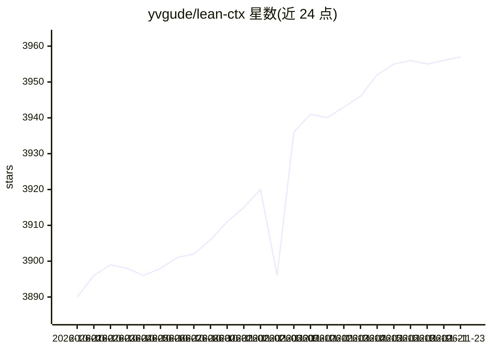

# yvgude/lean-ctx

⭐ 3,957 · Rust · Apache-2.0 · 推送 2026-11-22 · [GitHub](https://github.com/yvgude/lean-ctx) · [官网](https://leanctx.com) · 组织维护

**给 AI 编码工具做上下文选择的本地网关**

运行在 AI 工具与所读信息之间的开源引擎：以 CLI、MCP、hooks 与代理路径方式本地运行，提供 16 种文件读取模式、密度预算压缩、PathJail 路径约束、内容过滤、会话记忆与知识图谱，并记录可检视的上下文操作证据。宿主应用保留对模型调用与代理循环的控制。另有 SDK 形态与按许可授权的企业部署选项，安装矩阵区分一等路径与兼容参考。

## 筛选速览

| 维度 | 判定 | 备注 |
|---|---|---|
| AI 角色 | `ai-ecosystem` | LLM/agent 周边工具 |
| 许可风险 | `permissive` | Apache-2.0 |
| 部署形态 | `library` | 以包/库形式分发 |
| 模型依赖 | — | README 未给出锁定关系 |
| 硬件要求 | — | 无带数字的原话,不猜 |
| 安装摩擦 | `low` | 无编译、无系统依赖或容器化 |
| 成熟度 | — | 结构信号不足 |

## 能力要点

- 16 种读取模式与 density 压缩（Tree-sitter AST 覆盖 27 种语言）
- PathJail 路径权限、内容过滤器与上下文预算等配置化控制
- 会话记忆、知识图谱与属性图支持跨会话连续性
- cockpit/inspect/ctx_proof 提供本地用量账本与审计导出

## 适用场景

- 为 Claude Code/Cursor 等编码工具收窄每次读取的上下文
- 在组织内对 AI 工具的文件访问与内容过滤做统一控制
- 本地留存任务记录并跨会话检索代码与知识
- 对 AI 工具的上下文消耗与成本做本地测量与留证

## 场景标签

`知识图谱` `Agent 记忆` · 领域:Agent 开发

## 证据(README 行号)

> L16: LeanCTX sits between AI tools and the information they read. It selects
> L21: The open-source **LeanCTX | OSS** runs locally through CLI, MCP, hooks and proxy paths.
> L128: - **Host-owned model choice:** the host chooses the model and performs any model

## 星数曲线

2026-10-21 3,890 → 2026-11-23 3,957（+67）

---
*卡片 v1 · prompt 1.4 · 生成 2026-11-23 · 置信度 high · 依据 README sha `a94300beaefd` · [字段定义](../../DATASET.md)*
