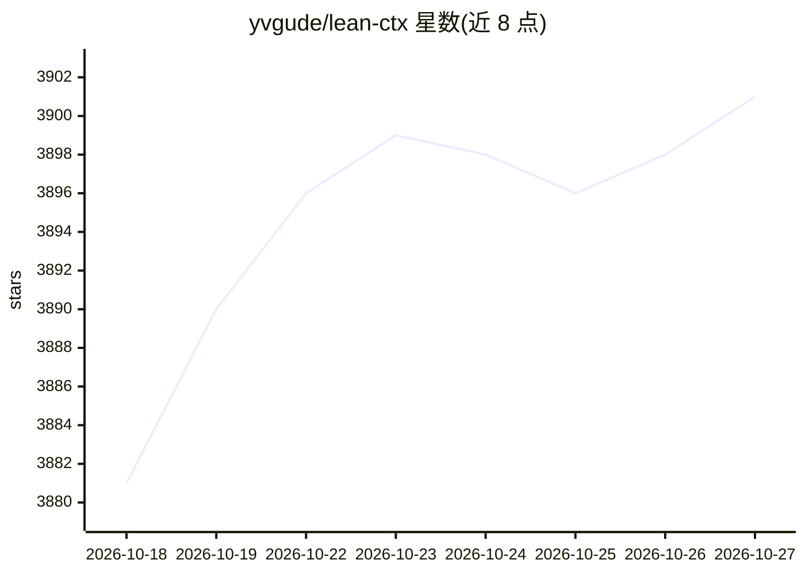

# yvgude/lean-ctx

⭐ 3,901 · Rust · Apache-2.0 · 推送 2026-10-26 · [GitHub](https://github.com/yvgude/lean-ctx) · [官网](https://leanctx.com) · 组织维护

**面向 AI 工具的上下文网关：筛选、管控并记录 AI 所读内容**

LeanCTX Engine 部署在 AI 编码工具与其读取的信息之间：以 16 种读取模式、密度压缩、Tree-sitter AST（27 种语言）和 85+ shell 输出压缩规则筛选任务相关上下文；通过 PathJail 路径限制、内容过滤器与上下文预算做管控；跨会话保留任务记录与代码/知识图谱；并记录策略决定与交付证据供 `lean-ctx inspect` 审查。以 CLI、MCP、hooks 和代理路径本地运行，另有可嵌入应用的 SDK；模型调用由宿主掌控。多数能力面向 Claude Code、Cursor、Codex 等现有工具集成。

## 筛选速览

| 维度 | 判定 | 备注 |
|---|---|---|
| AI 角色 | `ai-ecosystem` | LLM/agent 周边工具 |
| 许可风险 | `permissive` | Apache-2.0 |
| 部署形态 | `library` | 以包/库形式分发 |
| 模型依赖 | — | README 未给出锁定关系 |
| 硬件要求 | — | 无带数字的原话,不猜 |
| 安装摩擦 | `low` | 无编译、无系统依赖或容器化 |
| 成熟度 | `idea` | |

## 能力要点

- 16 种文件读取模式与确定性密度压缩（density 预算压缩）
- 85+ shell 输出压缩规则（git/npm/cargo/docker/kubectl/terraform 等）
- PathJail 路径权限、内容过滤器与上下文预算控制
- 会话记忆、知识图谱与属性图驱动的混合搜索
- 审计导出与 Context Proof 可验证审计轨迹

## 适用场景

- 降低 AI 编码工具重复读取与冗长命令输出占用的上下文窗口
- 对 AI 工具的文件访问和输出施加组织级内容控制
- 跨会话保留任务记录并检索代码与本地知识关联
- 导出上下文操作证据供审计

## 场景标签

 · 领域:AI 基础设施/上下文工程

## 证据(README 行号)

> L16: LeanCTX sits between AI tools and the information they read. It selects
> L21: The open-source **LeanCTX Engine** runs locally through CLI, MCP, hooks and proxy paths.
> L106: The Engine puts Select, Control, Learn and Prove into the context paths of your

## 星数曲线

2026-10-18 3,881 → 2026-10-27 3,901（+20）

---
*卡片 v1 · prompt 1.4 · 生成 2026-10-20 · 置信度 high · 依据 README sha `b3b7cf0dfc46` · [字段定义](../../DATASET.md)*
