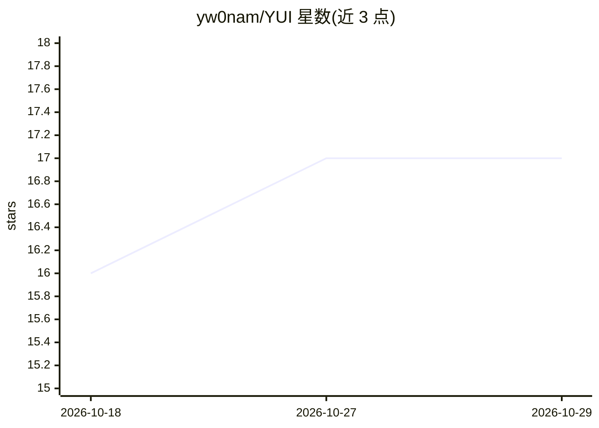

# yw0nam/YUI

⭐ 17 · TypeScript · NOASSERTION · 推送 2026-10-28 · [GitHub](https://github.com/yw0nam/YUI) · [官网](https://yw0nam.github.io/YUI/) · 个人维护

**桌面 VRM 陪伴角色：为任意 OpenAI 兼容后端提供形象、语音与桌面存在感**

面向个人用户的桌面虚拟伴侣应用：VRM 角色以透明置顶悬浮窗形式站在窗口上，头部与视线跟随鼠标，可在窗口间行走、跳跃与坐下。自身不内置模型（“YUI 是身体，接入的模型或 agent 是大脑”），通过 Chat Completions/push 协议连接 OpenAI、Ollama、LM Studio、Groq 或自建端点；TTS 与语音识别为独立连接。支持多角色同屏、主动搭话、浏览器检索、Claude Code/Codex 完成通知。限制：仅支持 Apple Silicon Mac 与 Windows x64；当前官方安装路径为借助编程 agent 安装，Releases 安装包早期且未签名；许可证为 PolyForm Noncommercial。

## 筛选速览

| 维度 | 判定 | 备注 |
|---|---|---|
| AI 角色 | `ai-native` | 本体是模型或模型工具 |
| 许可风险 | `none` | NOASSERTION |
| 部署形态 | `desktop` | 安装包/桌面程序 |
| 模型依赖 | local-ok | 支持本地模型 |
| 硬件要求 | — | 无带数字的原话,不猜 |
| 安装摩擦 | `low` | 无编译、无系统依赖或容器化 |
| 成熟度 | `idea` | |

## 能力要点

- VRM 角色桌面悬浮：视线跟随鼠标、窗口间行走跳跃、点拍有反应
- 不内置模型，接入任意 OpenAI 兼容端点或带 push 传输的自动化 agent
- 最多 4 个角色同屏共用一个会话窗口，各有独立人格、语音与记忆
- yui-notify 插件向 Claude Code / Codex 发送完成与待许可信号

## 适用场景

- 让本地或托管 LLM 以桌面角色形式陪伴并主动交流
- 通过语音与角色对话，角色识别屏幕内容后作答
- 编码 agent 完成任务时由角色转达通知

## 场景标签

 · 领域:桌面虚拟伴侣/AI 应用

## 证据(README 行号)

> L80: YUI is the body; the model or agent you plug in is the brain. YUI notices what happens (you sending a message, goin
> L88: |**Any OpenAI-compatible endpoint** (OpenAI · Ollama · LM Studio · Groq · your own endpoint)|Chat, persona text you

## 星数曲线

2026-10-18 16 → 2026-10-29 17（+1）

---
*卡片 v1 · prompt 1.4 · 生成 2026-10-29 · 置信度 high · 依据 README sha `d23a03800a19` · [字段定义](../../DATASET.md)*
