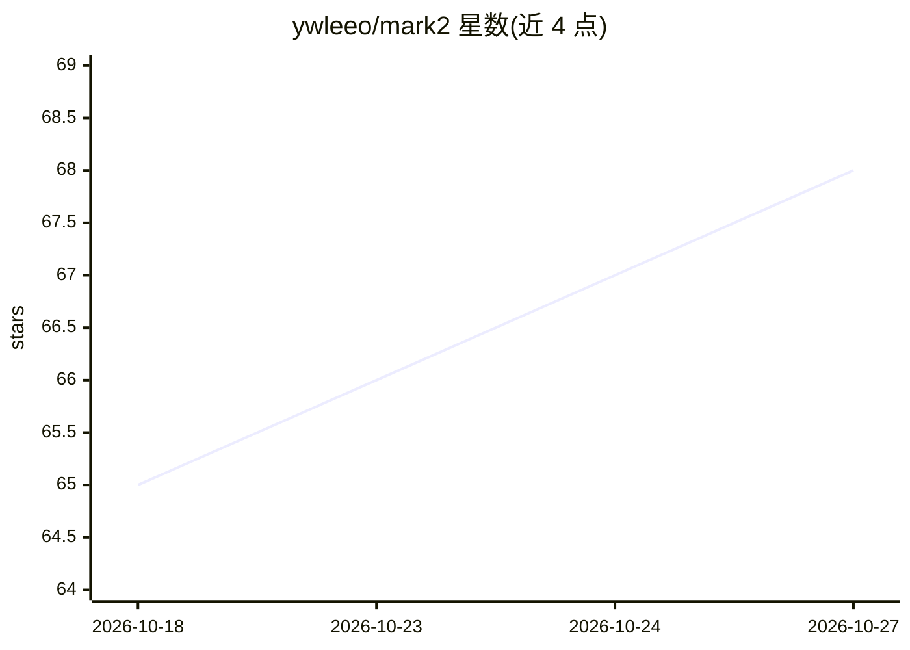

# ywleeo/mark2

⭐ 68 · JavaScript · MIT · 推送 2026-10-26 · [GitHub](https://github.com/ywleeo/mark2) · [官网](https://ywleeo.github.io/mark2/) · 个人维护 · 中文 README

**轻量离线 Markdown 写作桌面应用，内置 AI 续写与润色**

基于 Tauri（Rust）构建的 Markdown 桌面应用，安装包不到 30 MB，支持 macOS 与 Windows。集文件管理、所见即所得编辑、源码模式、文档大纲、KaTeX 公式、Mermaid 图表、PDF/代码/表格阅读于一体，支持卡片图导出与 GitHub Gist 分享。AI 功能嵌入写作上下文：光标处续写（ghost text，Tab 接受）、选区润色/扩写/精简/翻译，以及绑定当前文档的对话助手；AI 能力按用途可分别配置不同服务商的模型。API Key 以 AES-256-GCM 加密存本地。

## 筛选速览

| 维度 | 判定 | 备注 |
|---|---|---|
| AI 角色 | `ai-enhanced` | 去掉 AI 部分产品仍成立 |
| 许可风险 | `permissive` | MIT |
| 部署形态 | `library` | 以包/库形式分发 |
| 模型依赖 | — | README 未给出锁定关系 |
| 硬件要求 | — | 无带数字的原话,不猜 |
| 安装摩擦 | `low` | 无编译、无系统依赖或容器化 |
| 成熟度 | — | 结构信号不足 |

## 能力要点

- 光标处 ghost text 续写与选区润色/扩写/精简/翻译
- 与当前文档绑定的 AI 对话，可拆子任务并按文档保存上下文
- 支持 PDF、代码、表格、Word 导入与 Mermaid 图表
- 导出图片卡片与 GitHub Gist 分享链接

## 适用场景

- 写文章、技术方案和课程笔记并直接画流程图
- 读 PDF、代码和资料后整理成 Markdown
- 让 AI 在写作过程中续写、润色和翻译
- 把笔记片段导出成卡片发布到社交平台

## 场景标签

`AI 写作` `知识库管理` · 领域:内容生成

## 证据(README 行号)

> L9: 它把文件管理、Markdown 编辑、源码模式、文档大纲、代码查看、公式与 Mermaid 图表、PDF 阅读和卡片导出放在同一个工作区。AI 不作为常驻侧边栏打断写作，而是贴近具体上下文：在光标附近续写，在选中内容上润色、扩写、精
> L20: - **AI 融入写作过程**：不是让你输入命令、一次性吐出完整文章的 agent，而是写作时的协作者——在光标处续写，在卡住时给灵感，对选中内容润色、扩写、精简、翻译。

## 星数曲线

2026-10-18 65 → 2026-10-27 68（+3）

---
*卡片 v1 · prompt 1.4 · 生成 2026-10-24 · 置信度 mid · 依据 README sha `1ccc47d623db` · [字段定义](../../DATASET.md)*
