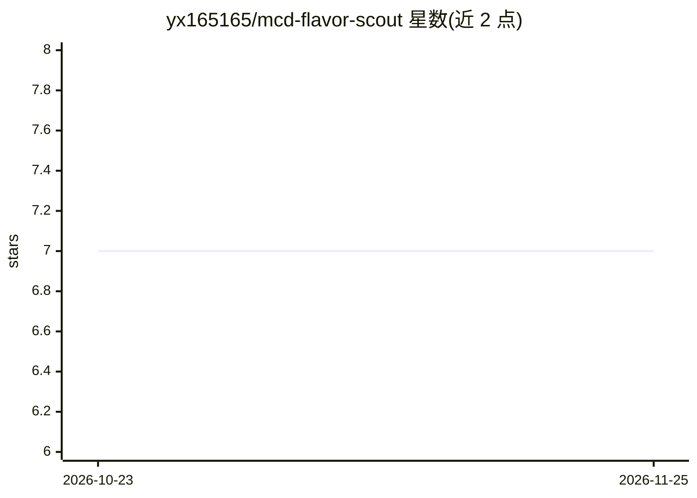

# yx165165/mcd-flavor-scout

⭐ — · [GitHub]() · 个人维护 · 中文 README

**按口味找麦当劳餐品的推荐工具：119 款手工口味图谱**

为麦当劳中国 119 款餐品手工标注六维口味+口感+温度向量，每条附配料依据并区分官方公示（51 条）、官网描述（13 条）、推断（55 条）三级来源。提供 CLI 与 MCP 形态：口味相似推荐（喜欢某餐品/口味描述/历史订单三种入口）、营养配餐、优惠券联合搜索、一句话点餐、口味对比、过敏原三级判定。营养与价格使用离线占位数据，真实运行需接入麦当劳 MCP。零依赖，Python 3.8+ 标准库即可运行。

## 筛选速览

| 维度 | 判定 | 备注 |
|---|---|---|
| AI 角色 | `ai-knowledge` | 知识聚合/清单类 |
| 许可风险 | `permissive` | — |
| 部署形态 | `None` |  |
| 模型依赖 | — | README 未给出锁定关系 |
| 硬件要求 | — | 无带数字的原话,不猜 |
| 安装摩擦 | `low` | 无编译、无系统依赖或容器化 |
| 成熟度 | — | 结构信号不足 |

## 能力要点

- 119 款餐品的口味向量图谱，逐条带 evidence 溯源字段
- 口味描述解析（口味/品类/预算）并按品类锁定推荐
- 过敏原三级判定（含/可能含/未发现）+ 无数据独立标记，宁可多报不漏报
- 优惠券与组合联合搜索求解实付最省方案

## 适用场景

- 我想吃点甜的、要酥脆的、不要牛肉，帮我找能吃的
- 我喜欢巨无霸，帮我找口味类似的其他餐品
- 预算 35 元还要控热量和蛋白质，帮我配一餐
- 对过敏原敏感，先查一下配料里可能有什么

## 场景标签

`推荐系统` · 领域:学习与行业

## 证据(README 行号)

> L23: 2. **把「口味」变成可计算的向量**，于是「推荐类似的」「按口味描述找」「从历史订单学偏好」这三种需求，都能用同一套相似度机制解决。
> L236: |`data/flavor_tags.json`|119 款餐品的口味标签（51 款可对应官方公示文件）|⚠️ **基于公开配料信息的结构化推断**，非官方数据。每条附 `evidence` 字段记录依据，可逐条溯源|

## 星数曲线

2026-10-23 7 → 2026-11-25 7（+0）

---
*卡片 v1 · prompt 1.4 · 生成 2026-11-20 · 置信度 mid · 依据 README sha `0316ec5d842d` · [字段定义](../../DATASET.md)*
