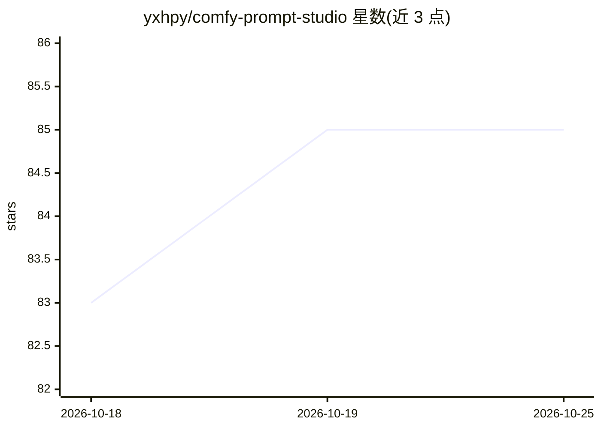

# yxhpy/comfy-prompt-studio

⭐ 84 · Python · MIT · 推送 2026-04-10 · [GitHub](https://github.com/yxhpy/comfy-prompt-studio) · 个人维护 · 中文 README

**AI图像生成Web应用：LLM提示词增强+ComfyUI工作流+实时推送**

基于 Flask + Flask-SocketIO 的 AI 图像生成 Web 应用：将用户输入的简单描述经 Ollama（本地）或 Gemini（云端）转换为 Stable Diffusion 提示词，调用 ComfyUI API 执行文生图或人脸替换工作流（自动切换），通过 WebSocket 实时推送生成进度与日志，历史记录存于 SQLite。需预先运行 ComfyUI（127.0.0.1:8188）与 Ollama 服务，通过 pip 安装依赖、.env 配置后以 python -m src.cli.run 启动。项目自述处于渐进式重构阶段，路由拆分等仍在进行。

## 筛选速览

| 维度 | 判定 | 备注 |
|---|---|---|
| AI 角色 | `ai-native` | 本体是模型或模型工具 |
| 许可风险 | `permissive` | MIT |
| 部署形态 | `library` | 以包/库形式分发 |
| 模型依赖 | local-ok | 支持本地模型 |
| 硬件要求 | — | 无带数字的原话,不猜 |
| 安装摩擦 | `low` | 无编译、无系统依赖或容器化 |
| 成熟度 | `idea` | |

## 能力要点

- Ollama/Gemini 双引擎提示词增强，.env 切换 AI_PROVIDER
- ComfyUI 工作流自动切换（普通文生图/人脸替换）
- WebSocket 实时推送生成进度与日志
- SQLite 历史记录管理与快速切换

## 适用场景

- 在网页上输入简单描述生成 Stable Diffusion 图像
- 利用本地 Ollama 无需外部 API key 增强提示词
- 做人脸替换生图并实时查看生成进度

## 场景标签

`图像生成` `提示工程` · 领域:Agent 开发

## 证据(README 行号)

> L19: - **智能提示词增强**：将简单的描述转换为专业的 Stable Diffusion 提示词
> L20: - **双AI引擎支持**：灵活切换 Ollama（本地）和 Gemini（云端）
> L112: - **图像生成**: ComfyUI API

## 星数曲线

2026-10-18 83 → 2026-10-25 85（+2）

---
*卡片 v1 · prompt 1.4 · 生成 2026-10-24 · 置信度 high · 依据 README sha `011bc07f8680` · [字段定义](../../DATASET.md)*
