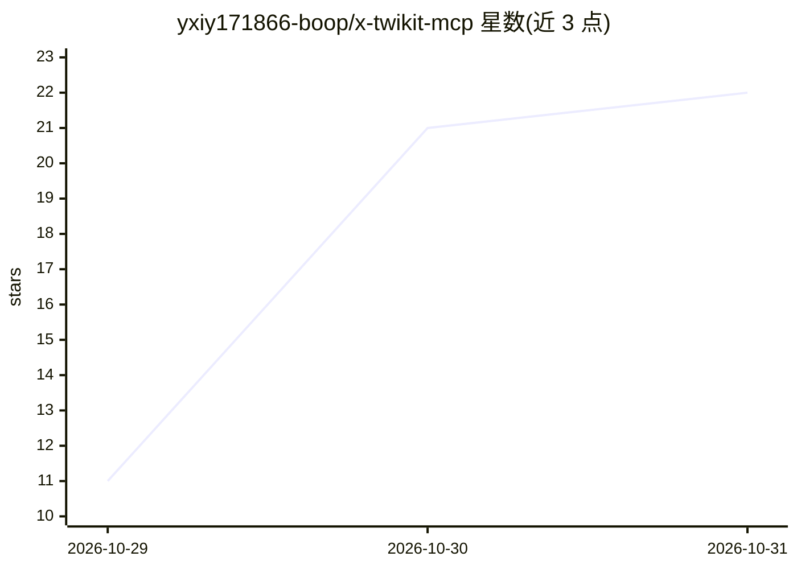

# yxiy171866-boop/x-twikit-mcp

⭐ 22 · Python · MIT · 推送 2026-10-30 · [GitHub](https://github.com/yxiy171866-boop/x-twikit-mcp) · 个人维护 · 中文 README

**让 AI 助手通过 MCP 协议操作 X (Twitter) 账号的服务端**

基于 twikit 库实现的 Model Context Protocol 服务端，通过普通账号的浏览器 Cookie（auth_token 与 ct0）与 X 官方 Web 端 GraphQL 接口通信，为 AI 助手、大语言模型及 Agent 提供 29 个工具：发推/回复/引用/删除、点赞转推收藏、推文与评论检索、高级搜索、用户资料与关注关系、通知与趋势、私信收发、优先账号追踪等。所有工具返回统一结构化 JSON（含失败状态）。需 Python 3.10+，git clone 后 pip 安装依赖，通过 stdio 接入 Claude Desktop、Cursor 等客户端。受平台风控限额限制。

## 筛选速览

| 维度 | 判定 | 备注 |
|---|---|---|
| AI 角色 | `ai-ecosystem` | LLM/agent 周边工具 |
| 许可风险 | `permissive` | MIT |
| 部署形态 | `library` | 以包/库形式分发 |
| 模型依赖 | — | README 未给出锁定关系 |
| 硬件要求 | — | 无带数字的原话,不猜 |
| 安装摩擦 | `low` | 无编译、无系统依赖或容器化 |
| 成熟度 | — | 结构信号不足 |

## 能力要点

- 29 个 MCP 工具覆盖发推、检索、私信、关注、趋势与优先账号追踪
- 统一 JSON 响应格式，失败状态显式标注避免误报
- Cookie（auth_token/ct0）认证，支持环境变量或配置文件两种方式
- 提供代理配置与错误码排查说明（限频/自动化判定/重复内容等）

## 适用场景

- 让 Claude Desktop 或 Cursor 中的 AI 助手代为发推、回复与管理 X 账号
- AI Agent 监听通知与私信并自动响应互动
- 聚合追踪特定重点账号的推文动态
- 通过自然语言让 AI 搜索推文并分析互动数据

## 场景标签

 · 领域:AI Agent 基础设施/社媒集成

## 证据(README 行号)

> L8: 本项目是基于 twikit 实现的 Model Context Protocol (MCP) 服务，专门为 AI 助手、大语言模型及各类 AI Agent 提供与 X (Twitter) 交互的能力。通过本服务，AI 能够自主调用工
> L10: 服务通过普通账号的浏览器 Cookie（`auth_token` 与 `ct0`）与 X 官方 Web 端通信。所有工具统一采用结构化 JSON 响应，确保状态判定与字段解析的稳定性。

## 星数曲线

2026-10-29 11 → 2026-10-31 22（+11）

---
*卡片 v1 · prompt 1.4 · 生成 2026-10-30 · 置信度 mid · 依据 README sha `bc56f951bb9c` · [字段定义](../../DATASET.md)*
