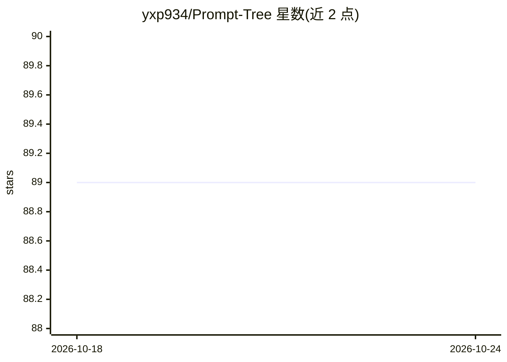

# yxp934/Prompt-Tree

⭐ 89 · TypeScript · 推送 2026-08-17 · [GitHub](https://github.com/yxp934/Prompt-Tree) · [官网](https://yxp934.github.io/Prompt-Tree/) · 个人维护 · 中文 README

**本地优先 AI 聊天客户端：以节点树分支管理对话与上下文**

基于 Next.js/React/TypeScript 的本地优先 AI 聊天客户端，把对话建模为可分支的节点 DAG，配合画布可视化管理线程。提供 Context Box 用于逐请求组装提示词（拖拽节点、排序、token 追踪与压缩），三层长期记忆（用户画像、记忆库、文件夹文档）与可选的记忆检索工具。支持多模型并行分支、OpenAI 兼容接口、Web Search/MCP/本地 Python 工具。会话存于浏览器 IndexedDB，需 Node.js 18+，通过 npm 全局安装后以 CLI 启动 Web 界面。

## 筛选速览

| 维度 | 判定 | 备注 |
|---|---|---|
| AI 角色 | `ai-native` | 本体是模型或模型工具 |
| 许可风险 | `none` | — |
| 部署形态 | `library` | 以包/库形式分发 |
| 模型依赖 | — | README 未给出锁定关系 |
| 硬件要求 | — | 无带数字的原话,不猜 |
| 安装摩擦 | `low` | 无编译、无系统依赖或容器化 |
| 成熟度 | — | 结构信号不足 |

## 能力要点

- 对话以节点 DAG 建模，可从任意节点分支并比较多模型输出
- Context Box 显式组装上下文：拖拽节点、排序、预览、token 追踪
- 三层长期记忆（Profile/Memory Bank/Folder Doc）+ search_memory 工具与可选 embeddings
- 链路压缩：将选定链或上下文压缩为紧凑节点，可解压还原

## 适用场景

- 长对话中分支探索多个方案而不丢失上下文
- 手工挑选并压缩历史节点，控制每次请求的 token 消耗
- 跨线程保留个人偏好与记忆，继续先前的讨论

## 场景标签

`聊天机器人` · 领域:对话与助手

## 证据(README 行号)

> L11: Prompt Tree is a **local-first AI chat client** that models each conversation as a **node-based DAG (a tree with br
> L27: - **Context Box**: drag nodes into a curated context, reorder, preview, and track tokens.

## 星数曲线

2026-10-18 89 → 2026-10-24 89（+0）

---
*卡片 v1 · prompt 1.4 · 生成 2026-10-23 · 置信度 high · 依据 README sha `4a537b4fd6e0` · [字段定义](../../DATASET.md)*
