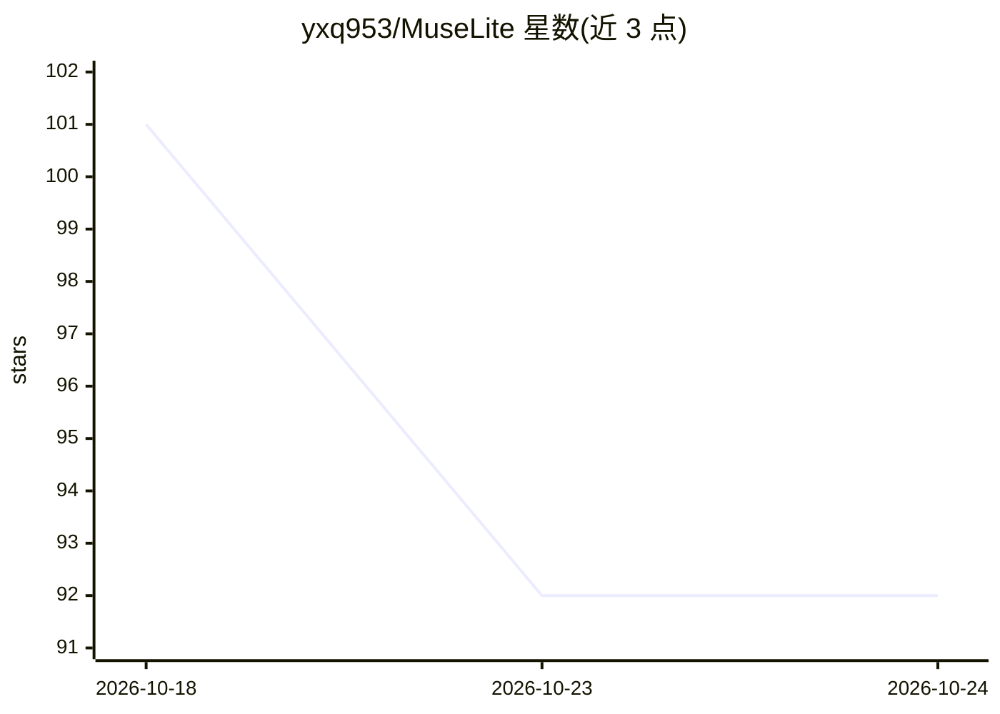

# yxq953/MuseLite

⭐ 92 · Python · GPL-3.0 · 推送 2026-10-10 · [GitHub](https://github.com/yxq953/MuseLite) · 个人维护 · 中文 README

**Android 原生 AI 工作台：聊天、Agent 工具、沙箱与手机控制**

面向 Android 11+ arm64 设备的 Python 优先 AI 工作台应用：内置 OpenAI 兼容 HTTPS 聊天客户端，会话与模型设置存于 SQLite，API 密钥经 Android Keystore 加密；提供 Agent 多步工具循环、可复用 Skills（含对话式 Skill Creator）、PRoot 持久 Alpine Linux 沙箱、浏览器工具、定时提示，以及经无障碍服务实现的可选手机操作（点击/滑动/截屏/剪贴板/聊天回复推荐）。构建需 Windows x86-64、Python 3.13，通过 build_windows.ps1 生成 debug APK；另有 Toga 桌面预览（不支持运行 Linux 脚本）。采用 GPL v3 许可。

## 筛选速览

| 维度 | 判定 | 备注 |
|---|---|---|
| AI 角色 | `ai-native` | 本体是模型或模型工具 |
| 许可风险 | `viral` | GPL-3.0 |
| 部署形态 | `desktop` | 安装包/桌面程序 |
| 模型依赖 | — | README 未给出锁定关系 |
| 硬件要求 | — | 无带数字的原话,不猜 |
| 安装摩擦 | `low` | 无编译、无系统依赖或容器化 |
| 成熟度 | — | 结构信号不足 |

## 能力要点

- OpenAI 兼容聊天客户端，会话/设置 SQLite 持久化，密钥 Android Keystore 加密
- PRoot 持久 Alpine Linux 沙箱执行 shell 命令与工作区文件管理
- Agent 通过无障碍服务操作手机：点击、滑动、截屏、剪贴板读写、聊天回复推荐
- 可复用 Skills 与对话式 Skill Creator，支持定时发送提示

## 适用场景

- 在 Android 手机上连接任意 OpenAI 兼容服务进行对话与多步 Agent 任务
- 让 Agent 在授权的沙箱里执行命令、保存文档到手机目录
- 定时发送提示词、让 Agent 协助起草聊天回复

## 场景标签

`GUI 自动化` `聊天机器人` · 领域:效率与自动化

## 证据(README 行号)

> L3: MuseLite is a Python-first AI workspace for Android. It combines an OpenAI-compatible chat client, persistent conver
> L15: - Optional Android phone control through the accessibility service and a foreground task service.

## 星数曲线

2026-10-18 101 → 2026-10-24 92（-9）

---
*卡片 v1 · prompt 1.4 · 生成 2026-10-23 · 置信度 high · 依据 README sha `f898bffc399d` · [字段定义](../../DATASET.md)*
