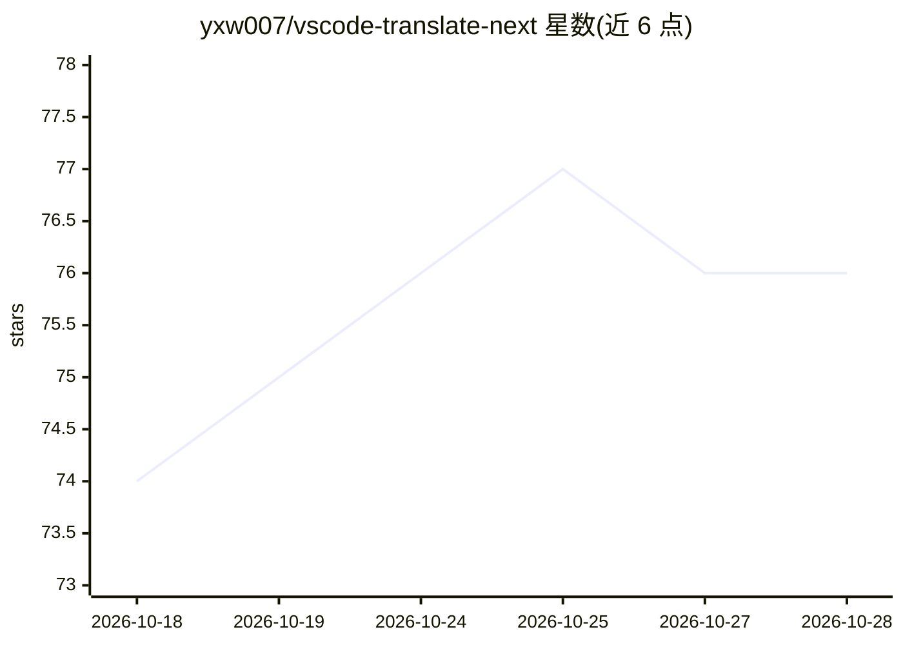

# yxw007/vscode-translate-next

⭐ 76 · CSS · MIT · 推送 2026-10-27 · [GitHub](https://github.com/yxw007/vscode-translate-next) · 个人维护 · 中文 README

**面向开发者的多引擎 VS Code 翻译插件**

一款 VS Code 翻译扩展，功能包括悬停翻译、注释翻译与一键批量替换、终端选中文本翻译、插件详情与 Markdown 预览沉浸式翻译等，支持按扩展名白名单自定义 Hover 生效范围。底层由 translate 提供翻译支持，内置 Google、Bing 免费引擎开箱即用，另可配置 Azure、Amazon、百度、DeepL、腾讯及自定义引擎（含 DeepSeek、智谱、千问等）。使用需在官网注册并登录，要求 VSCode >= 1.91.0。

## 筛选速览

| 维度 | 判定 | 备注 |
|---|---|---|
| AI 角色 | `ai-native` | 本体是模型或模型工具 |
| 许可风险 | `permissive` | MIT |
| 部署形态 | `None` |  |
| 模型依赖 | — | README 未给出锁定关系 |
| 硬件要求 | — | 无带数字的原话,不猜 |
| 安装摩擦 | `low` | 无编译、无系统依赖或容器化 |
| 成熟度 | — | 结构信号不足 |

## 能力要点

- 悬停翻译、注释批量替换、终端文本翻译、Markdown 沉浸式翻译
- 支持 8 类翻译引擎及自定义引擎接入
- Google/Bing 免费引擎无需配置开箱即用
- 提供翻译缓存与按需关闭特性以控制字符消耗

## 适用场景

- 写代码时悬停即译外文标识符与文档
- 批量把项目注释翻译替换为目标语言
- 在终端和插件详情页阅读外文内容时即选即译

## 场景标签

 · 领域:开发者工具/翻译

## 证据(README 行号)

> L13: - **Hover 翻译** — 鼠标悬停即译
> L36: ## 💻 支持的翻译引擎
> L72: - 配置自定义翻译引擎（内含 DeepSeek、智谱、千问、Xiaomi MiMo 等配置）

## 星数曲线

2026-10-18 74 → 2026-10-28 76（+2）

---
*卡片 v1 · prompt 1.4 · 生成 2026-10-24 · 置信度 high · 依据 README sha `632c639eeb12` · [字段定义](../../DATASET.md)*
