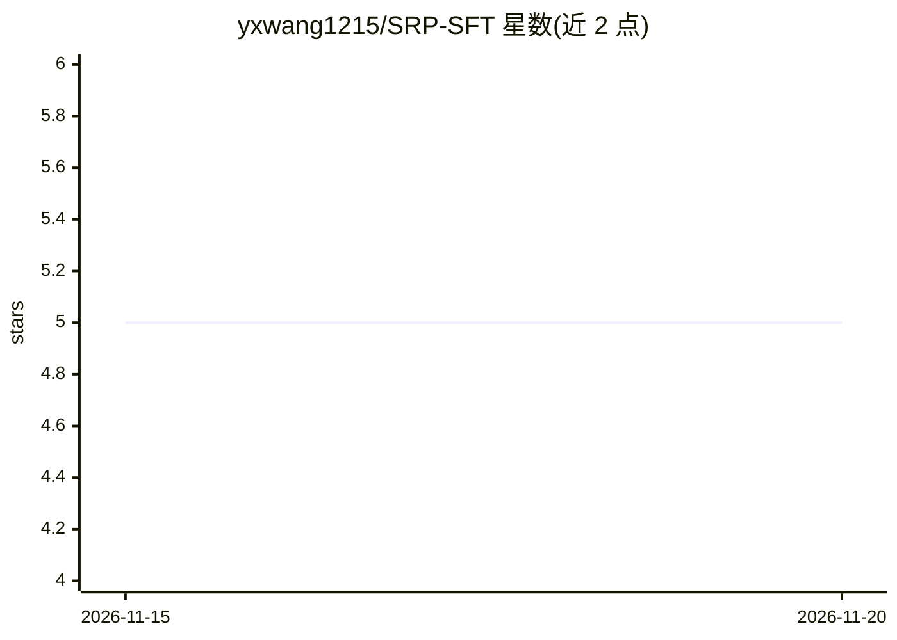

# yxwang1215/SRP-SFT

⭐ 5 · Python · 推送 2026-10-15 · [GitHub](https://github.com/yxwang1215/SRP-SFT) · [官网](https://yxwang1215.top/papers/srp-sft/) · 个人维护

**SFT 训练方法研究库：保序 logit margin 的微调实现**

实现 SRP-SFT/LP-SFT 等 SFT 训练方法与基线：冻结参考模型预计算非目标 token 的成对 logit margin 缓存，训练时对 margin 收缩施加单侧 hinge 辅助损失；覆盖缓存构建、DeepSpeed 训练、MATH-500/HumanEval+/MBPP+ 评测与 held-out 诊断。要求 Linux + Python 3.12，训练与缓存构建需 CUDA GPU（主设置 8×A800-80GB），目标示例与单元测试可在 CPU 运行；评测因 vLLM 与训练栈的 Transformers 版本不同需独立环境。

## 筛选速览

| 维度 | 判定 | 备注 |
|---|---|---|
| AI 角色 | `ai-ecosystem` | LLM/agent 周边工具 |
| 许可风险 | `none` | — |
| 部署形态 | `library` | 以包/库形式分发 |
| 模型依赖 | local-ok | 支持本地模型 |
| 硬件要求 | — | 无带数字的原话,不猜 |
| 安装摩擦 | `medium` | 含编译或系统依赖之一 |
| 成熟度 | — | 结构信号不足 |

## 能力要点

- 预计算参考信号缓存，训练无需再次前向参考模型
- CE/LP-SFT/SRP-SFT/DFT/EAFT/GEM/ASFT 共用训练入口
- 支持多种排序目标与配对图、候选来源等消融控制
- 评测含数学与代码基准及 held-out rank flip/margin/KL/entropy 诊断

## 适用场景

- 在数学推理与代码生成任务上做 SFT 方法对比实验
- 复现论文中的 Qwen3-4B-Base 训练与评测结果
- 研究非目标 token margin 保持对微调的影响

## 场景标签

`微调` `模型评测` · 领域:评测与运维

## 证据(README 行号)

> L12: SRP-SFT adds a selective margin-preservation objective to supervised fine-tuning. At each teacher-forced prefix, a 
> L14: This repository provides the implementation of **SRP-SFT**, **LP-SFT**, ranking objectives, and SFT baselines, with
> L46: Use **Python 3.12** on Linux. Cache construction and full-parameter training use CUDA GPUs; the main setting uses e

## 星数曲线

2026-11-15 5 → 2026-11-20 5（+0）

---
*卡片 v1 · prompt 1.4 · 生成 2026-11-20 · 置信度 mid · 依据 README sha `32cd5928cc8b` · [字段定义](../../DATASET.md)*
