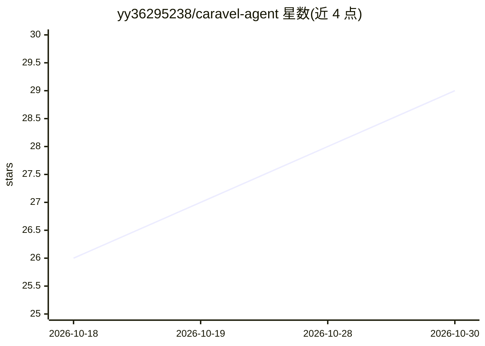

# yy36295238/caravel-agent

⭐ 29 · Apache-2.0 · 推送 2026-10-29 · [GitHub](https://github.com/yy36295238/caravel-agent) · [官网](https://caravel-site.pages.dev/) · 个人维护 · 中文 README

**本地优先的多 AI 编码 Agent 并行派发与代码验收工作台**

面向开发者的桌面工作台，把本地项目、任务、Agent 会话与代码验收集中管理：向不同项目并行派发任务、选择受支持的 Agent CLI（Claude Code、Codex、OpenCode、pi、Grok、TRAE、Antigravity），查看执行状态、接续会话、确认权限，审查代码 Diff 并在验收后合并推送独立分支。任务与会话保存在本机；调用在线模型时仍会联网。提供 macOS 与 Windows x64 安装包，需自备 Git 与已配置的 Agent CLI。应用源码保持私有，安装包以 Apache 2.0 授权。

## 筛选速览

| 维度 | 判定 | 备注 |
|---|---|---|
| AI 角色 | `ai-ecosystem` | LLM/agent 周边工具 |
| 许可风险 | `permissive` | Apache-2.0 |
| 部署形态 | `desktop` | 安装包/桌面程序 |
| 模型依赖 | — | README 未给出锁定关系 |
| 硬件要求 | — | 无带数字的原话,不猜 |
| 安装摩擦 | `low` | 无编译、无系统依赖或容器化 |
| 成熟度 | — | 结构信号不足 |

## 能力要点

- 跨项目并行派发任务给多种 Agent CLI
- 集中查看会话状态、确认权限并接续会话
- 代码 Diff 审查，验收后合并、推送独立分支
- 任务与会话数据保存在本机

## 适用场景

- 同时让多个 AI Agent 处理不同项目的编码任务
- 跟进多个 Agent 会话进度并在需要时介入调整
- 审查 Agent 产出的代码变更并合并到分支

## 场景标签

`编码 Agent` `代码审查` `多智能体` · 领域:Agent 开发

## 证据(README 行号)

> L9: 本地优先的多 AI 编码 Agent 工作台，把项目、任务、会话和代码验收放在一起。
> L34: - **并行派发**：给不同项目创建任务，选择 Agent，让多项工作同时推进。
> L43: 2. 准备 Git 和至少一个已安装、完成登录或配置的受支持 Agent CLI。

## 星数曲线

2026-10-18 26 → 2026-10-30 29（+3）

---
*卡片 v1 · prompt 1.4 · 生成 2026-10-26 · 置信度 high · 依据 README sha `3597c85aa734` · [字段定义](../../DATASET.md)*
