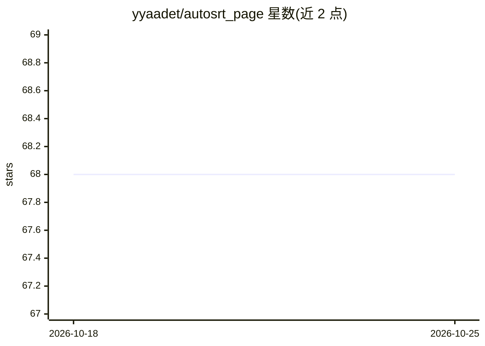

# yyaadet/autosrt_page

⭐ 68 · Swift · Apache-2.0 · 推送 2026-06-21 · [GitHub](https://github.com/yyaadet/autosrt_page) · [官网](https://yyaadet.github.io/autosrt_page/) · 个人维护 · 中文 README

**macOS 离线双语言幕生成应用：从视频自动产出字幕**

面向 macOS（M1 及以上）的桌面应用：读取本地视频文件，使用 whisper 模型（ggml-large-v3-turbo）转录语音生成字幕，并通过可切换的本地/远端 LLM（LLaMA 3、Qwen、Deepseek 等，支持 ollama 与 OpenAI API 格式）进行上下文感知的字幕翻译，同时输出两种语言的字幕。全程本地离线运行，附带字幕编辑器（搜索、批量替换、对齐）与字幕样式渲染。模型默认随应用下载，失败时可手动安装，README 另提供百度网盘下载渠道。

## 筛选速览

| 维度 | 判定 | 备注 |
|---|---|---|
| AI 角色 | `ai-native` | 本体是模型或模型工具 |
| 许可风险 | `permissive` | Apache-2.0 |
| 部署形态 | `desktop` | 安装包/桌面程序 |
| 模型依赖 | local-ok | 支持本地模型 |
| 硬件要求 | — | 无带数字的原话,不猜 |
| 安装摩擦 | `low` | 无编译、无系统依赖或容器化 |
| 成熟度 | — | 结构信号不足 |

## 能力要点

- whisper 模型转录 + LLM 上下文感知翻译，生成双语字幕
- 完全离线本地运行，视频不出本机
- 支持 LLaMA 3/Qwen/Deepseek 等模型切换，兼容 ollama 与 OpenAI API 格式
- 内置字幕编辑器与字体/颜色/边框样式渲染

## 适用场景

- 给外语视频快速生成中英等双语字幕
- 语言学习时对照两种语言的字幕
- 无网络环境下本地处理视频字幕

## 场景标签

`语音识别` · 领域:感知与多模态

## 证据(README 行号)

> L3: AutoSRT is a powerful desktop application that automatically generates dual language subtitles from video files. Run
> L13: - 🤖 **Flexible Model Support**: Switch between different LLM models like LLaMA 3, Qwen, Deepseek, QwQ and more easi
> L65: Download whisper model from ggml-large-v3-turbo.bin.zip .

## 星数曲线

2026-10-18 68 → 2026-10-25 68（+0）

---
*卡片 v1 · prompt 1.4 · 生成 2026-10-24 · 置信度 high · 依据 README sha `537d6ee8c656` · [字段定义](../../DATASET.md)*
