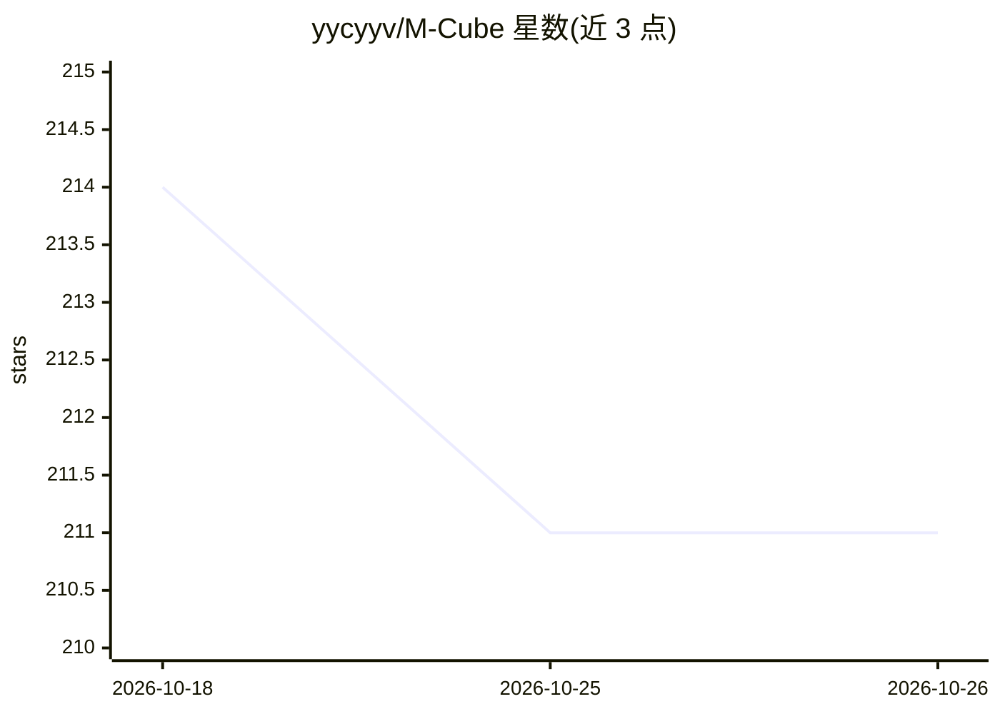

# yycyyv/M-Cube

⭐ 211 · Python · MIT · 推送 2026-05-23 · [GitHub](https://github.com/yycyyv/M-Cube) · 个人维护 · 中文 README

**多智能体协同的专利撰写与审查意见答复助手**

基于 LangGraph 多智能体编排的专利文件处理应用：读取专利文本与附图的多模态信息（PyMuPDF/Pillow + Vision LLM），提供专利申请文件撰写、OA 答复、在先技术对比、权利要求润色四类工作流，过程中执行说明书支持度检查、图文逻辑核验等验证，并在关键节点引入人工确认以规避 A33 超范围风险。架构为 FastAPI + React + Tauri，支持云 SaaS 与本地离线部署、Docker 一键启动及桌面 CLI 子进程模式。

## 筛选速览

| 维度 | 判定 | 备注 |
|---|---|---|
| AI 角色 | `ai-native` | 本体是模型或模型工具 |
| 许可风险 | `permissive` | MIT |
| 部署形态 | `desktop` | 安装包/桌面程序 |
| 模型依赖 | — | README 未给出锁定关系 |
| 硬件要求 | — | 无带数字的原话,不猜 |
| 安装摩擦 | `low` | 无编译、无系统依赖或容器化 |
| 成熟度 | — | 结构信号不足 |

## 能力要点

- LangGraph 多智能体编排，含对抗检查与思维链扩展
- Vision LLM 解析附图并做文图交叉映射验证
- 四类工作流：撰写/OA 答复/在先技术对比/权利要求润色
- 支持 Docker、本地 Web、Tauri 桌面及 CLI 子进程调用

## 适用场景

- 专利代理人根据技术交底书起草申请文件
- 答复审查意见并生成 A33 合规的替换页
- 对比在先技术文件并输出新颖性/创造性风险分级

## 场景标签

`多智能体` `AI 写作` · 领域:Agent 开发

## 证据(README 行号)

> L9: M-Cube is a multi-thinking, multimodal, and multi-verification multi-agent collaborative patent drafting assistant. 
> L35: 1. 📝 **Patent Drafting**: Performs atomic-level feature breakdown and drawing analysis based on technical disclosur

## 星数曲线

2026-10-18 214 → 2026-10-26 211（-3）

---
*卡片 v1 · prompt 1.4 · 生成 2026-10-22 · 置信度 mid · 依据 README sha `fb3974309002` · [字段定义](../../DATASET.md)*
