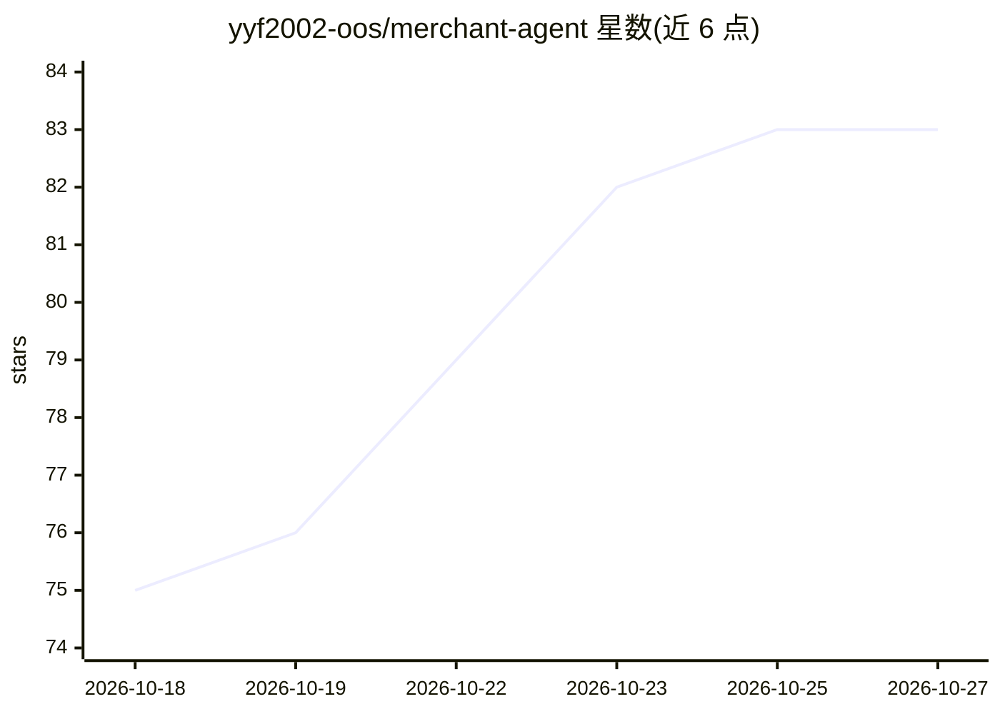

# yyf2002-oos/merchant-agent

⭐ 83 · Python · 推送 2026-07-18 · [GitHub](https://github.com/yyf2002-oos/merchant-agent) · 个人维护 · 中文 README

**电商商家用的 AI 全流程运营助手：选品/上架/客服/分析/货源**

面向电商商家的自动化运营系统：5 个 ReAct Agent 分别处理选品分析（淘宝下拉词+价格库）、上架素材生成、FAQ 客服应答、利润与定价分析、货源筛选。基于 DeepSeek 与 Ollama（qwen2 系列）混合模型路由，按任务分配不同提供者，故障时自动降级切换。提供 Gradio Web UI（带登录认证）与 CLI 两种界面，RAG 检索用 bge-m3 embedding + Milvus 向量库（不可用时回退内存余弦扫描），MySQL 不可用时回退 JSON 文件。注意：价格、供应商、产区数据来自本地静态 JSON，非实时电商 API 数据；单进程同步架构，并发受 LLM 限制。

## 筛选速览

| 维度 | 判定 | 备注 |
|---|---|---|
| AI 角色 | `ai-native` | 本体是模型或模型工具 |
| 许可风险 | `none` | — |
| 部署形态 | `self-host` | docker 或自建部署 |
| 模型依赖 | local-ok | 支持本地模型 |
| 硬件要求 | — | 无带数字的原话,不猜 |
| 安装摩擦 | `low` | 无编译、无系统依赖或容器化 |
| 成熟度 | — | 结构信号不足 |

## 能力要点

- DeepSeek + Ollama 混合模型路由，按 Agent 配置主/轻量模型并自动故障降级
- 电商对话 RAG：Milvus 向量检索历史对话，自动识别售前/改地址/使用/售后 4 阶段
- 一键工作流：输入品类自动执行选品→上架→客服→分析全流程
- Gradio Web UI 带用户认证、知识库在线管理与 LLM 调用/费用监控

## 适用场景

- 商家输入品类自动完成选品分析与上架素材生成
- 基于 FAQ 知识库和历史对话辅助客服回复
- 计算利润并获取定价与促销建议
- 按产业带数据筛选供应商并生成 1688 链接

## 场景标签

`RAG` `工作流自动化` · 领域:效率与自动化

## 证据(README 行号)

> L3: > AI 驱动的电商全流程自动化系统 — 选品 → 上架 → 客服 → 运营分析 → 货源筛选
> L11: |📋 **选品分析**|淘宝搜索下拉词获取 + 价格库查询 + 关键词评分 → 蓝海商品推荐|DeepSeek|
> L12: |📝 **上架素材**|标题生成(3平台) + 详情描述 + SEO优化 + 主图建议|Ollama|
> L13: |💬 **智能客服**|FAQ 知识库检索 + 历史笔记召回 + 情绪感知应答|Ollama|

## 星数曲线

2026-10-18 75 → 2026-10-27 83（+8）

---
*卡片 v1 · prompt 1.4 · 生成 2026-10-24 · 置信度 mid · 依据 README sha `306660772aaf` · [字段定义](../../DATASET.md)*
